# ERD galaxy schema – EduVision BI (Nhóm 03)

Khớp với `src/database/schema/01_schema_core.sql` và `02_schema_dims_facts.sql`. 6 bảng fact, 7 dimension, dùng chung dimension (galaxy schema).

```mermaid
erDiagram
    dim_time ||--o{ fact_review : time_key
    dim_platform ||--o{ fact_review : platform_key
    dim_source ||--o{ fact_review : source_key
    review_text ||--o| fact_review : review_key

    fact_review ||--o{ fact_review_aspect : review_key
    dim_aspect ||--o{ fact_review_aspect : aspect_key
    dim_time ||--o{ fact_review_aspect : time_key
    dim_platform ||--o{ fact_review_aspect : platform_key
    dim_model ||--o{ fact_review_aspect : model_key

    dim_platform ||--o{ fact_platform_period : platform_key
    dim_time ||--o{ fact_platform_period : time_key

    dim_platform ||--o{ fact_forecast : platform_key
    dim_time ||--o{ fact_forecast : time_key
    dim_model ||--o{ fact_forecast : model_key

    dim_source ||--o{ fact_news_sentiment : source_key
    dim_platform ||--o{ fact_news_sentiment : platform_key
    dim_time ||--o{ fact_news_sentiment : time_key

    dim_time ||--o{ fact_alert : time_key
    dim_platform ||--o{ fact_alert : platform_key
    dim_aspect |o--o{ fact_alert : aspect_key

    dim_platform ||--o{ dim_app_version : platform_key
    dim_platform |o--o{ dim_event : platform_key

    review_text {
        bigint review_key PK
        text review_id
        text source
        text text
        text lang_guess
        text text_hash
    }
    dim_time {
        integer time_key PK
        date full_date
        smallint week
        smallint month
        smallint quarter
        smallint year
    }
    dim_platform {
        integer platform_key PK
        text platform_name
        text platform_group
        text play_id
        text ios_id
    }
    dim_source {
        smallint source_key PK
        text source_name
        text source_type
    }
    dim_aspect {
        smallint aspect_key PK
        text aspect_name
    }
    dim_app_version {
        smallint app_version_key PK
        integer platform_key FK
        text version_name
        date release_date
        text release_notes
    }
    dim_event {
        integer event_key PK
        text event_type
        date start_date
        date end_date
        text description
        integer platform_key FK
        boolean needs_review
    }
    dim_model {
        smallint model_key PK
        text model_name
        text model_version
        date trained_at
    }
    fact_review {
        bigint review_key PK, FK
        integer time_key FK
        integer platform_key FK
        smallint source_key FK
        smallint rating
        integer thumbs_up
    }
    fact_review_aspect {
        bigint review_key PK, FK
        smallint aspect_key PK, FK
        integer time_key FK
        integer platform_key FK
        smallint model_key FK
        text sentiment_label
        numeric sentiment_score
        numeric confidence
    }
    fact_platform_period {
        integer platform_key PK, FK
        integer time_key PK, FK
        integer new_review_count
        numeric positive_rate
        numeric negative_rate
        numeric avg_rating
        numeric sentiment_index
        numeric bhi
        numeric review_share_in_group
    }
    fact_forecast {
        integer platform_key PK, FK
        integer time_key PK, FK
        smallint model_key PK, FK
        numeric forecast_value
        numeric ci_lower
        numeric ci_upper
        numeric actual_value
    }
    fact_news_sentiment {
        smallint source_key PK, FK
        text article_id PK
        integer platform_key PK, FK
        integer time_key FK
        numeric sentiment_score
        text sentiment_label
        numeric confidence
        integer mention_count
    }
    fact_alert {
        bigint alert_key PK
        integer time_key FK
        integer platform_key FK
        smallint aspect_key FK
        text metric_name
        numeric metric_value
        numeric threshold
        timestamptz detected_at
        text status
    }
```

## Grain

| Fact | Grain |
|---|---|
| fact_review | 1 đánh giá |
| fact_review_aspect | 1 đánh giá × 1 khía cạnh |
| fact_platform_period | 1 nền tảng × 1 tháng |
| fact_forecast | 1 nền tảng × 1 kỳ dự báo × 1 mô hình |
| fact_news_sentiment | 1 bài báo × 1 nền tảng được nhắc |
| fact_alert | 1 cảnh báo |

## Cần xác nhận

Chỗ đề cương (mục 7) chưa rõ hoặc khác với tệp 01 (không sửa theo yêu cầu):

- **dim_time (tệp 01)** thiếu `hour` (giờ), `day_of_week` (thứ) và `is_weekend`, trong khi đề cương mục 7.2 có.
- **dim_platform (tệp 01)** thiếu nhà phát triển; nhóm hiện là `trong_nuoc`/`quoc_te`, còn đề cương ghi nhóm "học tổng hợp, ngoại ngữ".
- **dim_source (tệp 01)** `source_type` hiện là `kho_ung_dung/youtube/bao_chi/khac`, đề cương ghi loại "API, RSS, công khai, CSV".
- **fact_review (tệp 01)** thiếu điểm cảm xúc, nhãn cảm xúc, độ dài, cờ lệch pha mà đề cương liệt kê trong số đo.
- **dim_app_version**: thêm `platform_key`; đề cương không nêu liên kết nền tảng.
- **dim_event**: thêm `platform_key` (rỗng nếu sự kiện chung) và `needs_review` (dòng "cần kiểm tra").
- **fact_review_aspect**: thêm `time_key`, `platform_key`, `model_key` ngoài đề cương.
- **fact_platform_period**: `time_key` = ngày đầu tháng; thang Sentiment Index và BHI chưa chốt.
- **fact_forecast**: M3 dự báo cả Sentiment Index và tỷ lệ tiêu cực nhưng grain không có cột chỉ số.
- **fact_news_sentiment**: không có dimension bài báo, dùng `article_id` làm dimension suy biến; chưa có nơi lưu tiêu đề/nội dung bài.
- **fact_alert**: tập giá trị `status`; nơi lưu đề xuất hành động và bộ phận phụ trách.
