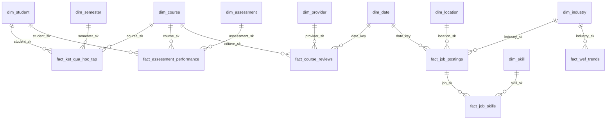

# Thiết kế Data Warehouse & Business Intelligence (Nhóm 05 - 65HTTT)

- **Thành viên phụ trách:** Nguyễn Quang Đức (MSV: `2351160512`)
- **Vai trò:** Data Warehouse & Business Intelligence (PostgreSQL Star Schema, ETL Pipeline, Apache Superset Dashboards)

---

## 1. Mục tiêu
Xây dựng kho dữ liệu tập trung (**Data Warehouse**) theo mô hình **Star Schema** trên **PostgreSQL 16.x**, tích hợp dữ liệu từ 4 nguồn sạch của nhóm (`OULAD`, `Course Reviews`, `VietJobs`, `WEF Trends`) và trực quan hóa trên **Apache Superset** thông qua 3 Dashboard nghiệp vụ:
1. **Dashboard 1:** Quản lý học vụ
2. **Dashboard 2:** Chất lượng đào tạo
3. **Dashboard 3:** Xu hướng ngành nghề

---

## 2. Kiến trúc Data Warehouse (Star Schema - Schema `dw`)

Kho dữ liệu được tách biệt khỏi tầng staging (`public.*`) vào schema `dw` thông qua tệp DDL [dw_star_schema.sql](../src/database/dw_star_schema.sql).

### 2.1. Các bảng Dimension (`dw.dim_*`)
| Bảng | Mô tả | Khóa chính (PK) |
| :--- | :--- | :--- |
| `dw.dim_date` | Chiều thời gian chuẩn (2025–2027) hỗ trợ phân tích theo ngày/tuần/tháng/quý | `date_key` (YYYYMMDD) |
| `dw.dim_semester` | Học kỳ / đợt triển khai khóa học (Spring `B`, Fall `J`) | `semester_sk` |
| `dw.dim_course` | Danh mục khóa học hợp nhất từ OULAD và Course Reviews | `course_sk` |
| `dw.dim_student` | Thông tin nhân khẩu học và trình độ học vấn của học viên | `student_sk` |
| `dw.dim_assessment` | Danh mục bài kiểm tra/đánh giá (`TMA`, `CMA`, `Exam`) và trọng số | `assessment_sk` |
| `dw.dim_provider` | Nhà cung cấp / nền tảng giảng dạy (`DeepLearning.AI`, `Coursera`, `Udemy`, `OULAD`) | `provider_sk` |
| `dw.dim_industry` | Ngành nghề tuyển dụng Việt Nam & lĩnh vực WEF | `industry_sk` |
| `dw.dim_location` | Địa điểm tuyển dụng & phân vùng (`Miền Bắc`, `Miền Nam`, `Miền Trung`, `Remote`) | `location_sk` |
| `dw.dim_skill` | Danh mục kỹ năng chuẩn hóa & phân nhóm (`AI & Data Engineering`, `Database & BI`, `Cloud & DevOps`, `Programming & Backend`) | `skill_sk` |

### 2.2. Các bảng Fact (`dw.fact_*`)
| Bảng | Mức chi tiết (Grain) | Chỉ số chính (Measures) |
| :--- | :--- | :--- |
| `dw.fact_ket_qua_hoc_tap` | 1 học viên × 1 học phần × 1 học kỳ | `total_clicks`, `active_days`, `avg_score`, `assessments_completed`, `is_completed`, `is_dropout`, `risk_level` |
| `dw.fact_assessment_performance` | 1 học viên × 1 bài đánh giá | `score`, `date_submitted`, `is_passed_assessment` |
| `dw.fact_vle_engagement` | 1 học viên × 1 học phần × 1 loại tài nguyên VLE | `total_clicks`, `active_days_count` |
| `dw.fact_course_reviews` | 1 lượt đánh giá khóa học | `rating`, `sentiment`, `sentiment_score`, `helpful_count`, `issue_topic` |
| `dw.fact_job_postings` | 1 tin tuyển dụng tại Việt Nam | `salary_min_mil`, `salary_max_mil`, `salary_avg_mil`, `is_salary_negotiable` |
| `dw.fact_job_skills` | 1 tin tuyển dụng × 1 kỹ năng yêu cầu | Bridge Fact phục vụ đếm nhu cầu kỹ năng & mức lương theo kỹ năng |
| `dw.fact_wef_trends` | 1 xu hướng nghề nghiệp/kỹ năng quốc tế (WEF) | `growth_rate_pct`, `reskilling_months`, `global_demand_level`, `vietnam_relevance` |

---

## 3. Quy trình ETL nạp Data Warehouse
1. **SQL ETL:** [dw_etl_from_staging.sql](../src/database/dw_etl_from_staging.sql) chuyển đổi dữ liệu từ bảng staging (`public.*`) sang Star Schema (`dw.*`), tự động sinh `dim_date`, tách chuỗi `required_skills` sang `dim_skill` + `fact_job_skills`, và phân loại chủ đề phản hồi `issue_topic`.
2. **Python ETL:** [etl_warehouse.py](../src/database/etl_warehouse.py) nạp **toàn bộ** dữ liệu sạch từ `data/processed/` (không giới hạn 500 dòng), tổng hợp log `studentVle_cleaned.csv` vào `dw.fact_vle_engagement`, và cập nhật toàn bộ BI Views.

---

## 4. Các Dashboard BI trên Apache Superset

### Dashboard 1: Quản lý học vụ (`dw_views_academic.sql`)
- **KPIs (`dw.v_bi_academic_kpi`):** Tổng số học viên, Tỷ lệ hoàn thành khóa học (`Pass` + `Distinction`), Tỷ lệ không hoàn thành (`Fail` + `Withdrawn`).
- **Funnel Chart (`dw.v_bi_academic_funnel`):** Tỷ lệ học viên duy trì / rời bỏ qua 4 giai đoạn: *Đăng ký -> Có tương tác VLE -> Nộp >= 3 bài đánh giá -> Hoàn thành đạt chuẩn*.
- **Bảng cảnh báo sớm (`dw.v_bi_high_risk_students`):** Danh sách học viên có nguy cơ cao/trung bình không hoàn thành khóa học.
- **Biểu đồ kết quả (`dw.v_bi_learning_outcomes_by_course`):** Thống kê kết quả học tập theo học phần và học kỳ.

### Dashboard 2: Chất lượng đào tạo (`dw_views_quality.sql`)
- **KPIs (`dw.v_bi_quality_kpi`):** Điểm đánh giá trung bình khóa học (`avg_course_rating`).
- **Donut/Pie Chart (`dw.v_bi_feedback_issues`):** Tỷ lệ phản hồi tích cực, trung tính và tiêu cực.
- **Heatmap (`dw.v_bi_difficulty_heatmap`):** Tỷ lệ làm sai / không đạt theo học phần và loại bài đánh giá (`TMA`, `CMA`, `Exam`).
- **Biểu đồ cột (`dw.v_bi_provider_comparison`):** So sánh chất lượng (điểm rating TB) giữa các nhà cung cấp / giảng viên.
- **Biểu đồ vấn đề (`dw.v_bi_feedback_issues`):** Các vấn đề phổ biến trong phản hồi (tốc độ giảng nhanh, thiếu bài tập thực hành, nội dung khó...).

### Dashboard 3: Xu hướng ngành nghề (`dw_views_careers.sql`)
- **Top ngành nghề (`dw.v_bi_industry_demand`):** Số lượng tin tuyển dụng theo ngành nghề & khu vực.
- **Time-Series (`dw.v_bi_job_trends_timeseries`):** Xu hướng nhu cầu tuyển dụng theo thời gian.
- **Top kỹ năng (`dw.v_bi_top_skills_demand`):** Các kỹ năng được doanh nghiệp Việt Nam yêu cầu nhiều nhất.
- **Mức lương (`dw.v_bi_industry_demand`):** Mức lương trung bình theo ngành nghề (Triệu VNĐ).
- **Đối chiếu VN vs Quốc tế (`dw.v_bi_vn_vs_global_trends`):** So sánh xu hướng tăng trưởng toàn cầu (WEF) với số lượng tin tuyển dụng & mức lương thực tế tại Việt Nam (VietJobs).
