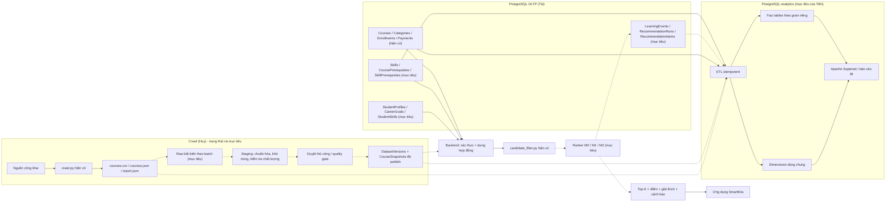

# Hợp đồng dữ liệu AI gợi ý & vùng Analytics

> Phạm vi: đặc tả đầu vào dùng chung cho `M0/M1/M2`, luồng OLTP/Crawl tới AI và
> Data Warehouse (DW), cùng grain và cấu trúc Star Schema đề xuất.
>
> Trạng thái: **Thiết kế mục tiêu — chờ xác nhận của Tài, Huy và nhóm**. Tài liệu
> này là một đặc tả hoàn chỉnh để rà soát, không phải bằng chứng đã có thảo luận
> hay đồng thuận. Các thành phần chưa có trong repository được ghi rõ là mục tiêu.

## 1. Cơ sở và phạm vi triển khai

Hợp đồng này dựa trên:

- Danh sách trường Crawl hiện tại: `id`, `title`, `url`, `price_vnd`,
  `original_price_vnd`, `categories`, `category_slugs`, `image_url`,
  `crawled_at`; `description`, `date_published`, `date_modified` chỉ có thể có
  khi chạy chế độ lấy chi tiết. Xem [README dữ liệu Crawl](../../data/README.md).
- Kế hoạch mở rộng dữ liệu nguồn gồm `provider`, `language`, `level`, `skills`,
  `prerequisites`, `duration_minutes`, `price_amount`, `price_currency`,
  `direct_skills`, `inferred_skills`, `offer_type`, trạng thái chất lượng và
  phát hành `dataset_version`. Các trường này là mục tiêu của pipeline Huy,
  chưa phải cam kết rằng chúng đã được triển khai.
- OLTP hiện có: `courses`, `categories`, `users`, `enrollments`, `payments`,
  `material_progress`, `lesson_progress`, `quiz_attempts`. Ví dụ:
  [Course](../../src/backend/app/models/course.py),
  [Enrollment](../../src/backend/app/models/enrollment.py),
  [Payment](../../src/backend/app/models/payment.py).
- Hồ sơ học tập, kỹ năng, tiên quyết, đơn hàng, hoàn tiền, `LearningEvents`,
  `DatasetVersions`, `RecommendationRuns`, `RecommendationItems` và
  `ModelEvaluations` là các bảng được nêu trong kế hoạch mở rộng tại
  [phân công nhóm](../../danhsachnhom.md), chưa được đăng ký trong
  [models/__init__.py](../../src/backend/app/models/__init__.py).

Tài liệu này thiết kế hợp đồng và kiến trúc, không tạo migration hay khẳng định
đã có dữ liệu lịch sử cho các bảng chưa triển khai.

### 1.1. Hợp đồng phát hành `DatasetVersions` (đề xuất)

`DatasetVersions` là metadata bất biến của một lần phát hành; dữ liệu khóa cụ
thể nằm trong `CourseSnapshots` và các bảng liên kết skill/category. Không sửa
snapshot của version đã phát hành: thay đổi dữ liệu phải tạo version mới. Tên
bảng/field dưới đây là hợp đồng đề xuất để Tài và Huy đối chiếu trước khi tạo
model/Alembic migration.

| Thực thể | Trường đề xuất | Bắt buộc sau phát hành | Quy tắc |
|---|---|---:|---|
| `DatasetVersions` | `id` UUID PK, `version` string UNIQUE, `status`, `is_active`, `created_at`, `published_at`, `created_by`, `approved_by`, `approved_at`, `record_count`, `manifest_sha256`, `schema_version`, `change_summary` | `id`, `version`, `status`, `published_at`, `approved_by`, `approved_at`, `record_count`, `manifest_sha256`, `schema_version` | `status` tối thiểu `draft`, `published`, `retired`; chỉ version `published` được đọc bởi AI. `is_active` là con trỏ tiện ích, không thay thế version cố định của request; partial unique index bảo đảm tối đa một version active nếu dùng. |
| `CourseSnapshots` | `id` UUID PK, `dataset_version_id` FK, `course_id` FK nullable, `source_name`, `source_course_id`, `canonical_url`, `title`, `description`, `provider`, `language`, `level`, `price_amount`, `price_currency`, `duration_minutes`, `required_hours_per_week`, `popularity_score`, `offer_type`, `quality_status`, `quality_flags`, `approval_status`, `captured_at`, `snapshot_hash` | ID, version, `offer_type`, `title`, trạng thái duyệt/chất lượng, `captured_at`, `snapshot_hash` | Một catalog version phải chứa cả khóa `INTERNAL` lẫn `EXTERNAL_REFERENCE` đủ điều kiện; `course_id` liên kết khóa OLTP khi có. Unique partial index: `(dataset_version_id, course_id)` cho INTERNAL; `(dataset_version_id, source_name, canonical_url)` cho EXTERNAL_REFERENCE. `source_course_id` giữ ID nguồn nếu có; `canonical_url` chuẩn hóa luôn bắt buộc cho khóa ngoài. |
| `CourseSnapshotSkills` | `course_snapshot_id` FK, `skill_id` FK, `skill_origin`, `confidence`, `review_status` | khóa hai phía, `skill_origin` | `skill_origin` phân biệt `direct` và `inferred`; unique `(course_snapshot_id, skill_id, skill_origin)`. |
| `CourseSnapshotCategories` | `course_snapshot_id` FK, `category_id` FK, `source_category_label` | khóa hai phía | Bảng liên kết để không nhét danh sách nhiều giá trị vào một cột và tránh nhân dòng Fact khi join. |

`approved_by` tham chiếu actor quản trị theo cơ chế RBAC của OLTP; `created_by`
và người duyệt có thể là cùng người chỉ khi chính sách nhóm cho phép. Release
version hóa **toàn bộ catalog AI** (nội bộ và external), không chỉ file Crawl:
nhờ đó một request tái lập được cả nội dung khóa nội bộ lẫn dữ liệu Crawl tại
cùng thời điểm. Bản ghi
`EXTERNAL_REFERENCE` là dữ liệu tham khảo, không trở thành mặt hàng nội bộ được
bán. Những bản ghi thiếu trường tùy chọn vẫn có thể được duyệt nếu quality gate
cho phép; giá/thời lượng thiếu phải lưu `null`.

Enum đề xuất cần dùng thống nhất giữa API, snapshot và quản trị:

- `DatasetVersions.status`: `draft`, `published`, `retired`;
- `CourseSnapshots.quality_status`: `approved_candidate`, `needs_review`,
  `rejected` (đánh giá tự động chất lượng);
- `CourseSnapshots.approval_status`: `pending_review`, `approved`, `rejected`
  (quyết định duyệt của người có quyền);
- `offer_type`: `INTERNAL`, `EXTERNAL_REFERENCE`.

`approved_candidate` không đồng nghĩa `approved`: chỉ `quality_status =
approved_candidate AND approval_status = approved` trong version `published`
mới đủ điều kiện cấp cho recommender. Không cho phép trạng thái không nhận diện
lọt qua mặc định.

### 1.2. Hiện trạng mã nguồn cần tôn trọng

- Crawler hiện tại xuất `courses.csv`/`courses.json` với `id`, `title`, `url`,
  `price_vnd`, `original_price_vnd`, `categories`, `category_slugs`,
  `image_url`, `crawled_at`; `description`, `date_published` và `date_modified`
  chỉ có thể có khi chạy `--details`. Crawler chưa sinh kỹ năng, taxonomy hay
  bản phát hành `DatasetVersions`.
- PostgreSQL hiện có `courses`, `categories`, `enrollments`, `payments`,
  `material_progress`, `lesson_progress` và `quiz_attempts`. Hồ sơ học tập,
  taxonomy, `CourseSnapshots`, `DatasetVersions`, `LearningEvents`,
  `RecommendationRuns`/`RecommendationItems` và schema `analytics` chưa có
  model/migration trong repository.
- Bộ lọc cứng đã được triển khai tại
  [candidate_filter.py](../../src/ai/src/recommendations/candidate_filter.py)
  và có kiểm thử. Các ranker M0/M1/M2, adapter API và xử lý phiên bản dataset
  chưa được tích hợp với bộ lọc này; hợp đồng dưới đây xác định ranh giới cần có,
  không khẳng định luồng gợi ý đầu-cuối đã hoạt động.

## 2. Nguyên tắc hợp đồng

1. Dùng `snake_case`, UUID cho khóa định danh nội bộ và thời gian ISO-8601 UTC.
   Giá lưu dưới dạng số chính xác (`NUMERIC`/`Decimal`) kèm currency; không dùng
   binary float để tính tiền. Fact giao dịch DW chuẩn hóa sang minor unit integer.
2. `null` nghĩa là **không biết/không được cung cấp**; không đổi `null` thành
   `0`, chuỗi rỗng, `BEGINNER`, hoặc giá trị mặc định suy đoán.
3. Với danh sách: `null` nghĩa là chưa biết/chưa nạp; `[]` nghĩa là đã biết và
   danh sách hiện rỗng. Không đồng nhất hai trạng thái này.
4. Chỉ dữ liệu khóa đã duyệt trong đúng `dataset_version` được cấp cho
   recommender. Không đưa dữ liệu `raw`/`staging` hoặc bản bị từ chối vào tập
   ứng viên.
5. Cả `M0`, `M1`, `M2` nhận cùng hồ sơ, phiên bản dữ liệu và tập ứng viên sau
   lọc cứng. Khác biệt giữa mô hình chỉ nằm ở cách xếp hạng.
6. Ghi lại `model_version`, `dataset_version`, dấu thời gian và các thành phần
   điểm để tái lập kết quả; không đưa thông tin nhận dạng trực tiếp vào DW.

## 3. Hợp đồng đầu vào Recommender

### 3.1. Hồ sơ học viên và ràng buộc truy vấn

Đây là hợp đồng chuẩn hóa đề xuất giữa API Backend và AI. Backend chịu trách
nhiệm xác thực quyền sở hữu `student_id`; ID này chỉ ở Backend envelope. AI
nhận profile đã dựng sẵn, không nhận UUID người dùng; kết quả offline có thể
dùng `learner_key` HMAC giả danh để đối chiếu.

| Trường | Kiểu / bắt buộc | Có thể `null`? | Nguồn và quy tắc |
|---|---|---:|---|
| `request_id` | UUID, bắt buộc | Không | ID duy nhất cho lượt yêu cầu; dùng đối chiếu log. |
| `student_id` | UUID, chỉ Backend | Không | Dùng để xác thực và đọc OLTP; không gửi trong feature payload/ranker hoặc log AI. Backend tạo `learner_key` giả danh nếu cần nối session. |
| `learner_key` | string giả danh, khi cần liên kết run/profile | Có | Không đảo ngược về `student_id`; không đồng thời cần `student_id` ở AI. |
| `dataset_version_id` | UUID FK, bắt buộc | Không | Trỏ `DatasetVersions.id`; version phải `published` và được cố định cho toàn bộ lượt xếp hạng. |
| `profile.goals` | mảng `{goal_id, label?}` | Có | Mục tiêu nghề nghiệp từ hồ sơ/taxonomy; `null` khi chưa khai báo. |
| `profile.current_skills` | mảng skill object | Có | Kỹ năng đã có từ hồ sơ hoặc intake; mỗi phần tử theo cấu trúc bên dưới. |
| `profile.target_level` | enum `BEGINNER`, `INTERMEDIATE`, `ADVANCED` | Có | Cấp độ do người học khai báo hoặc quy đổi theo intake; lưu nguồn riêng. |
| `profile.level_source` | enum `self_report`, `intake_test`, `null` | Có | Không suy ra nguồn khi thiếu dữ liệu. |
| `constraints.max_budget_amount` | số chính xác không âm | Có | Ngân sách tối đa; `null` thì bỏ lọc ngân sách, không phải miễn phí. |
| `constraints.currency` | ISO 4217 | Có | Bắt buộc nếu ngân sách có giá trị; chưa xác định thì `null`. |
| `constraints.available_hours_per_week` | số không âm | Có | `null` thì không áp dụng lọc theo quỹ thời gian; `0` là đã khai báo không có thời gian học. |
| `constraints.purchased_course_ids` | mảng course ID | Có | Backend dựng từ đơn thanh toán thành công; `null` là chưa biết, `[]` là đã kiểm tra và không có. |
| `constraints.enrolled_course_ids` | mảng course ID | Có | Backend dựng từ enrollment còn hiệu lực; `null` là chưa biết, `[]` là đã kiểm tra và không có. |
| `constraints.completed_course_ids` | mảng course ID | Có | Backend dựng từ trạng thái hoàn thành; `null` là chưa biết, `[]` là đã kiểm tra và không có. |
| `constraints.exclude_course_ids` | mảng course ID | Có | Các khóa người học chủ động loại; `null` là chưa biết, `[]` là không loại khóa nào. Adapter hợp nhất trường này vào danh sách loại trừ trước khi gọi bộ lọc. |
| `constraints.allowed_offer_types` | mảng không rỗng `INTERNAL`/`EXTERNAL_REFERENCE` | Không | Backend phải truyền rõ chính sách hiển thị. Không dựa vào mặc định `filter_candidates`; phải từ chối request nếu policy chưa được xác định. |
| `top_k` | số nguyên dương | Không | Số kết quả tối đa. |
| `model` | `M0`, `M1`, hoặc `M2` | Không | Cho phép chọn mô hình để đánh giá/demo. |

`current_skills` dùng cấu trúc:

| Trường | Kiểu / bắt buộc | Có thể `null`? | Quy tắc |
|---|---|---:|---|
| `skill_id` | string | Không | ID ổn định trong taxonomy chung. |
| `proficiency` | enum hoặc số đã chuẩn hóa `[0,1]` | Có | `null` nếu chưa đo; không tự gán mức trung bình. |
| `source` | `self_report`, `intake_test`, `verified`, `null` | Có | Phân biệt kỹ năng tự khai báo với kết quả kiểm tra/xác minh. |
| `confidence` | số `[0,1]` | Có | Độ tin cậy của ánh xạ/đánh giá; `null` nếu chưa có. |

Adapter chuẩn hóa object mục tiêu/kỹ năng thành taxonomy ID/label mà
`filter_candidates` và ranker nhận được; giữ `source`, `proficiency`,
`confidence` trong payload để giải thích và đánh giá. Không coi `null` và `[]`
là cùng trạng thái ở API/telemetry, dù ranker văn bản có thể bỏ qua cả hai khi
tạo query text.

### Ánh xạ trường từ nguồn nghiệp vụ và dataset

| Feature/hành vi | Nguồn ưu tiên | Quy tắc dựng input |
|---|---|---|
| Mục tiêu nghề nghiệp | `StudentProfiles`/`CareerGoals` (chưa có model) | Chỉ gửi mục tiêu đang hiệu lực; chưa khai báo thì `goals: null`, không đoán từ ngành học. |
| Kỹ năng hiện có | `StudentSkills` (kế hoạch), gắn taxonomy `Skills`; nguồn có thể là tự khai báo hoặc intake test | Giữ `skill_id`, mức độ, `source`, `confidence`; không trộn kỹ năng mục tiêu của khóa vào kỹ năng đã đạt. |
| Cấp độ | Hồ sơ/intake test đã xác nhận | Gửi cùng `level_source`; không có dữ liệu thì `null`. |
| Ngân sách và giờ học | `StudentProfiles` (kế hoạch) | Chỉ lọc theo giá/thời lượng khi cả giá trị hồ sơ và dữ liệu khóa cần thiết đều có; trường thiếu sinh warning. |
| Đã mua/đã học | `payments`/`enrollments` hiện có và `Orders` nếu được triển khai | Backend dựng riêng danh sách đã mua, đang ghi danh và hoàn thành theo trạng thái nghiệp vụ; `null` biểu thị chưa truy vấn được, không đổi thành `[]`; không dựa vào `view_count` để kết luận đã học. |
| Metadata khóa nội bộ | `courses` hiện có (`id`, `title`, `description`, `price_vnd`, `status`, `level`, `language`, `requirements`, `learning_outcomes`, `category_id`, `tags`) | `price_vnd` ánh xạ sang `price_amount` với currency `VND`; `status` cần mapping tường minh sang approval gate, không coi mọi khóa tồn tại là `approved`. |
| Metadata khóa Crawl | Crawler hiện xuất `id`, `title`, `url`, `price_vnd`, `original_price_vnd`, `categories`, `category_slugs`, `image_url`, `crawled_at`; mô tả/ngày chỉ khi dùng `--details` | Đặt `source_name = khoahocre`; `id` thành source ID ổn định, `url` chuẩn hóa; `price_vnd` dùng VND. Trường kỹ năng, provider, level, language và workload hiện không có nên giữ `null`, không suy diễn. |
| Danh mục | `categories` hiện có cho OLTP; taxonomy/danh mục nguồn trong snapshot | Ánh xạ qua ID chuẩn; không nối danh sách category trực tiếp vào Fact. |
| Kỹ năng mục tiêu/tiên quyết khóa | `CourseSkills`, `CoursePrerequisites`, `Skills`, `SkillPrerequisites` (kế hoạch) | `CoursePrerequisites` là prerequisite theo course ID cho hard filter; `SkillPrerequisites` là thứ tự học theo skill ID, không tráo hai loại quan hệ. Chỉ dùng taxonomy/version đã duyệt. |
| Thuộc tính thanh toán/ghi danh | `payments` hiện có (`amount_vnd`, `payment_status`, `paid_at`) và `enrollments` | Chỉ giao dịch xác nhận mới tính doanh thu; hợp đồng đơn/hoàn tiền tương lai phải giữ liên kết đến order item/payment. |
| Tiến độ học | `material_progress`, `lesson_progress`, `quiz_attempts` hiện có; `LearningEvents` là kế hoạch | Nguồn hiện tại phù hợp snapshot tiến độ; phân tích hoạt động theo ngày cần sự kiện có timestamp hoặc quy tắc attribution được chốt. |

### 3.2. Bản ghi khóa học được cấp cho mô hình

Một bản ghi ứng viên gồm trường nguồn đã được chuẩn hóa và kiểm duyệt. Trường
không có trong nguồn phải giữ `null`; không tự điền giá, thời lượng, cấp độ hay
kỹ năng.

| Trường | Kiểu / bắt buộc | Có thể `null`? | Ghi chú |
|---|---|---:|---|
| `course_id` | string ID ổn định, bắt buộc | Không | UUID stringify cho khóa nội bộ; `<source_name>:<source_course_id>` hoặc `<source_name>:url:<sha256(canonical_url)>` khi nguồn Crawl thiếu ID. Duy nhất trong toàn catalog. |
| `dataset_version_id` | UUID FK, bắt buộc | Không | Phải khớp `DatasetVersions.id` trong request; snapshot nội bộ và Crawl cùng version catalog. |
| `source_name` | string | Có | Nguồn Crawl; bổ sung cho bộ lọc nguồn/D1. |
| `source_course_id` | string | Có | ID khóa ở nguồn ngoài; không thay thế `course_id`. |
| `canonical_url` | URL | Có | URL gốc đã chuẩn hóa; bắt buộc với khóa tham khảo ngoài. |
| `title` | string | Không | Có ở `courses.title` và bản ghi Crawl. |
| `description` | string | Có | Có thể thiếu; mô hình văn bản không được giả định mô tả tồn tại. |
| `provider` | string | Có | Trường mục tiêu của pipeline Crawl. |
| `category_ids` | mảng ID | Có | Kết hợp taxonomy nội bộ và mapping danh mục nguồn nếu có. |
| `skills` | mảng skill ID | Có | Tập kỹ năng taxonomy đã chuẩn hóa, không lặp; `null` là chưa biết, `[]` là đã rà soát và không có kỹ năng. Dùng cho độ phủ M2, không cộng lặp với direct/inferred. |
| `language` | mã ngôn ngữ | Có | Chuẩn hóa BCP 47/ISO đã thống nhất; không suy đoán từ tên khóa. |
| `level` | `BEGINNER`, `INTERMEDIATE`, `ADVANCED`, `ALL_LEVELS` | Có | Chuẩn hóa cấp độ nguồn sang enum; giữ `null` nếu thiếu/không ánh xạ được, không dùng `UNKNOWN`. |
| `price_amount` | số không âm | Có | `null` không có nghĩa là miễn phí. |
| `price_currency` | ISO 4217 | Có | Bắt buộc khi `price_amount` có giá trị. |
| `duration_minutes` | số nguyên dương | Có | Giá trị thiếu giữ `null`; chỉ dùng lọc thời gian khi có quy tắc quy đổi được nhóm chấp thuận. |
| `required_hours_per_week` | số không âm | Có | Tải học ước tính/tuần đã được nguồn cung cấp hoặc nhóm xác nhận; không thể suy ra chỉ từ `duration_minutes`. Nếu người học có giới hạn giờ/tuần mà trường này thiếu, ứng viên bị loại vì chưa xác minh được ràng buộc. |
| `popularity_score` | số không âm | Có | Chỉ dùng cho fallback; nguồn và công thức phải được chốt, không mặc định đồng nhất với rating hoặc lượt đăng ký. Thiếu dữ liệu giữ `null`. |
| `direct_skills` | mảng skill object | Có | Kỹ năng nêu trực tiếp trên nguồn; mỗi mục gồm `skill_id`, `source`, `confidence`. |
| `inferred_skills` | mảng skill object | Có | Kỹ năng suy luận; giữ nguồn/confidence và cờ rà soát, không gộp âm thầm vào kỹ năng trực tiếp. |
| `prerequisite_course_ids` | mảng `course_id` | Có | Đầu vào `CoursePrerequisites` cho hard filter; `null` là chưa biết, `[]` là đã biết không có tiên quyết. |
| `prerequisite_skill_ids` | mảng skill ID | Có | Feature riêng cho lộ trình kỹ năng; không thay thế `prerequisite_course_ids` trong hard filter. |
| `offer_type` | `INTERNAL` / `EXTERNAL_REFERENCE` | Không | Phân biệt khóa nội bộ và khóa tham khảo ngoài. |
| `approval_status` | enum trạng thái | Không | Chỉ `approved` được đưa vào tập ứng viên. |
| `quality_status` | `approved_candidate`, `needs_review`, `rejected` | Không | Chỉ `approved_candidate` và snapshot thuộc version `published` được xét tiếp. |
| `quality_flags` | mảng string | Có | Cờ thiếu trường/chất lượng; `[]` khi đã kiểm tra và không có cờ. |
| `snapshot_hash` | SHA-256 string | Không | Hash canonical của các feature đã chuẩn hóa, dùng xác minh input/version; không thay thế `dataset_version_id`. |

Mỗi object trong `direct_skills`/`inferred_skills` có hợp đồng:

| Trường | Kiểu / bắt buộc | Có thể `null`? | Quy tắc |
|---|---|---:|---|
| `skill_id` | string taxonomy ID | Không | ID phải tồn tại trong taxonomy version của snapshot. |
| `source` | string | Không | Nguồn/provenance của ánh xạ; không để trống hoặc tự tạo. |
| `confidence` | số `[0,1]` | Có | `null` nếu nguồn không cung cấp hoặc chưa tính. |
| `review_status` | `pending_review`, `approved`, `rejected` | Không | Chỉ feature đã duyệt mới được dùng làm candidate input; giá trị gốc được giữ để audit. |

`prerequisite_skill_ids` và `prerequisite_course_ids` dùng cùng quy ước danh sách:
`null` là chưa biết; `[]` là đã kiểm tra và không có prerequisite.

Ví dụ một snapshot hợp lệ có một số feature tùy chọn chưa biết:

```json
{
  "course_id": "khoahocre:123",
  "dataset_version_id": "00000000-0000-4000-8000-000000000003",
  "source_name": "khoahocre",
  "source_course_id": "123",
  "canonical_url": "https://example.invalid/course/123",
  "title": "Nhập môn phân tích dữ liệu",
  "description": "Mô tả đã được kiểm tra từ nguồn.",
  "provider": null,
  "category_ids": null,
  "language": "vi",
  "level": "BEGINNER",
  "price_amount": null,
  "price_currency": null,
  "duration_minutes": null,
  "required_hours_per_week": null,
  "popularity_score": null,
  "skills": ["sql"],
  "direct_skills": [{"skill_id": "sql", "source": "source", "confidence": null}],
  "inferred_skills": null,
  "prerequisite_course_ids": [],
  "prerequisite_skill_ids": null,
  "offer_type": "EXTERNAL_REFERENCE",
  "approval_status": "approved",
  "quality_status": "approved_candidate",
  "quality_flags": [],
  "snapshot_hash": "sha256:..."
}
```

`approval_status = approved` không tự bỏ qua quality gate. Nếu nhóm yêu cầu
description/skills/level là trường bắt buộc để phát hành, snapshot thiếu chúng
phải ở staging/`needs_review`; các trường tùy chọn như price/workload vẫn có thể
`null` và chỉ bị loại khi profile bật filter phụ thuộc trường đó.

### 3.3. Ý nghĩa đầu vào theo mô hình

| Mô hình | Sử dụng | Không được làm |
|---|---|---|
| `M0` — TF-IDF | Query text từ `goals`, nhãn `current_skills` và mục tiêu văn bản; course text từ `title`, `description`, `skills`, `direct_skills`, `inferred_skills`. Score cosine chuẩn hóa `[0,1]`. | Bỏ qua text null/rỗng, không bịa token; dùng fallback phổ biến chỉ sau hard filter. |
| `M1` — Embedding | Cùng nội dung đã chuẩn hóa như M0, mã hóa bằng model đa ngữ; cache key gồm snapshot/version và embedding model version. | Không dùng embedding cũ cho snapshot khác; score phải đưa về `[0,1]`, không coi cosine là xác suất. |
| `M2` — Hybrid | `S` semantic relevance, `G` coverage của kỹ năng mục tiêu còn thiếu, `L` level fit; trọng số mục tiêu `0.50/0.35/0.15`, score `[0,100]`. | Không dùng giá/hoa hồng để tăng thứ hạng; feature thiếu phải là `null`, không gán điểm 0 giả. |

Để so sánh công bằng, mỗi ranker nhận cùng `dataset_version_id`, profile đã
chuẩn hóa và đúng cùng candidate IDs sau hard filter. Gợi ý triển khai `S`:
TF-IDF cosine của M0 vốn thuộc `[0,1]`; cosine M1 thuộc `[-1,1]` được ánh xạ
`(cosine + 1) / 2`. `G` chỉ tính trên taxonomy đã xác nhận và kỹ năng còn thiếu;
`L` theo bảng ánh xạ level được nhóm phê duyệt. Khi thành phần không tính được,
giữ component là `null`, ghi `effective_weights` sau chuẩn hóa trên các
components có dữ liệu và gắn `partial_score`; nếu không có component dùng được,
chuyển sang fallback đã lọc. Báo cáo NDCG/Precision phải phân tầng theo
completeness để partial score không bị hiểu như cùng độ tin cậy.

Trước filter, Backend phải xác thực version `published`, nạp đúng snapshot,
quality gate và quyền xem. `filter_candidates` hiện kiểm tra
`approval_status == approved`, `offer_type`, các course IDs đã mua/ghi danh/
hoàn thành, ngân sách/tiền tệ, workload tuần và prerequisite mapping; hàm không
kiểm tra dataset version hoặc `quality_status`, nên adapter chịu trách nhiệm
cho hai điều kiện đó. Phải truyền `allowed_offer_types` rõ ràng, vì mặc định
trong hàm cho phép cả `INTERNAL` lẫn `EXTERNAL_REFERENCE`.

Nếu ngân sách hoặc giờ/tuần của người học là `null`, filter tương ứng bị bỏ qua
và field được thêm vào `missing_fields_warning`. Nếu constraint đã biết nhưng
giá/tiền tệ hoặc workload khóa chưa biết, ứng viên bị loại với lý do
`price_unknown`, `price_currency_unknown` hoặc `weekly_workload_unknown`.
Workload chỉ so với `required_hours_per_week`; không suy từ tổng
`duration_minutes`. Prerequisite mapping có entry rỗng nghĩa là đã xác nhận
không có prerequisite; thiếu entry/giá trị `null`, prerequisite chưa hoàn thành
hoặc completion history `null` khi khóa có prerequisite đều bị loại (fail
closed). Khi danh sách lịch sử mua/ghi danh/hoàn thành là `null`, filter hiện
chỉ cảnh báo và vẫn có thể trả ứng viên; vì vậy Backend phải chặn request
online cho đến khi truy vấn được lịch sử, không gọi filter và không đổi `null`
thành `[]`. Offline evaluation chỉ chạy khi mỗi tập lịch sử được khai báo rõ;
`[]` chỉ dùng khi đã xác nhận rỗng.

`filter_candidates` sắp candidate theo `course_id` ổn định, trả `rejected_candidates`,
`candidate_warnings` và `missing_fields_warning`. Fallback pool chỉ gồm ứng
viên hợp lệ, sắp popularity giảm dần rồi `course_id` tăng dần, giới hạn mặc
định 5; popularity `null` xếp cuối. Candidate IDs và `fallback_candidates`
không được tạo bằng cách nới bất kỳ hard filter nào. Bộ lọc và unit tests đã có;
M0/M1/M2 ranker/orchestrator chưa có trong repository.

### 3.4. Bản ghi tái lập lượt gợi ý

Mỗi lượt chạy cần lưu tối thiểu:

```json
{
  "request_id": "uuid",
  "model": "M2",
  "model_version": "string",
  "dataset_version_id": "00000000-0000-4000-8000-000000000003",
  "created_at": "ISO-8601 UTC",
  "candidate_set_hash": "string",
  "items": [
    {
      "course_id": "uuid",
      "rank": 1,
      "score": 73.85,
      "score_scale": "0-100",
      "score_components": {"S": 0.72, "G": null, "L": 0.80},
      "effective_weights": {"S": 0.7692, "G": null, "L": 0.2308},
      "score_status": "partial",
      "explanation_evidence": [],
      "warnings": []
    }
  ]
}
```

`candidate_set_hash` là checksum của ID ứng viên sau lọc theo thứ tự chuẩn hóa;
không chứa PII. `score_scale` phải khai báo thang điểm của `score`; với `M2`,
công thức mục tiêu cho ra thang `[0,100]`; M0/M1 dùng `[0,1]`. Điểm không phải
xác suất thành công. Các score component thiếu phải giữ `null`, không thay bằng
0; `effective_weights` phải chỉ rõ trọng số thực tế. Lời giải thích chỉ được
dẫn từ dữ liệu hồ sơ/khóa hoặc cờ thiếu trường đã ghi nhận.

Ví dụ payload chuẩn dưới đây minh họa `null` khác với danh sách rỗng; ID chỉ là
giá trị minh họa, không phải seed dữ liệu:

```json
{
  "request_id": "00000000-0000-4000-8000-000000000001",
  "learner_key": "pseudonymous-learner-key",
  "dataset_version_id": "00000000-0000-4000-8000-000000000003",
  "model": "M2",
  "top_k": 5,
  "profile": {
    "goals": null,
    "current_skills": [],
    "target_level": null,
    "level_source": null
  },
  "constraints": {
    "max_budget_amount": null,
    "currency": "VND",
    "available_hours_per_week": null,
    "purchased_course_ids": [],
    "enrolled_course_ids": [],
    "completed_course_ids": [],
    "exclude_course_ids": [],
    "allowed_offer_types": ["INTERNAL"]
  }
}
```

Trong ví dụ: hồ sơ đã biết hiện chưa có skill nào (`[]`), mục tiêu/cấp độ chưa
được khai báo (`null`), ngân sách/giờ học chưa biết nên không áp dụng hai bộ lọc
này. Các lịch sử khóa rỗng (`[]`) nghĩa là Backend đã kiểm tra và xác nhận không
có; nếu chưa truy vấn được, phải gửi `null`, không gửi `[]`. `student_id` chỉ
được Backend dùng để dựng payload và không được chuyển xuống ranker.

## 4. Luồng dữ liệu OLTP, Crawl, AI và DW



Đường liền biểu diễn thành phần hiện có; đường chấm biểu diễn luồng tích hợp/
release mục tiêu chưa hoàn tất. DW sẽ đọc OLTP và catalog release qua ETL; AI
chỉ đọc hồ sơ/taxonomy do Backend cho phép và snapshot đã duyệt. Không dùng
schema `analytics` làm nguồn ghi nghiệp vụ, và không cho AI đọc raw/staging.

## 5. Star Schema đề xuất cho `analytics`

Tên logic trong sơ đồ theo yêu cầu nhóm (`DimDate`, `FactEnrollment`, v.v.).
Tên vật lý PostgreSQL nên viết thường `snake_case` và không quote: ví dụ
`analytics.dim_date`, `analytics.dim_student`,
`analytics.fact_recommendation_event`, `analytics.etl_batch_logs`. `analytics`
là schema riêng, không dùng chung namespace với các bảng OLTP.

### 5.1. Sơ đồ quan hệ và grain

```mermaid
erDiagram
    DIM_DATE ||--o{ FACT_CASH_TRANSACTION : transaction_date
    DIM_DATE ||--o{ FACT_ENROLLMENT : enrolled_date
    DIM_DATE ||--o{ FACT_LEARNING_DAILY : activity_date
    DIM_DATE ||--o{ FACT_RECOMMENDATION_EVENT : recommendation_date
    DIM_DATE ||--o{ FACT_DATASET_COURSE : snapshot_date
    DIM_DATE ||--o{ FACT_MODEL_EVALUATION : evaluation_date

    DIM_STUDENT ||--o{ FACT_ENROLLMENT : student
    DIM_STUDENT ||--o{ FACT_LEARNING_DAILY : student
    DIM_STUDENT ||--o{ FACT_RECOMMENDATION_EVENT : student

    DIM_COURSE ||--o{ FACT_CASH_TRANSACTION : course
    DIM_COURSE ||--o{ FACT_ENROLLMENT : course
    DIM_COURSE ||--o{ FACT_LEARNING_DAILY : course
    DIM_COURSE ||--o{ FACT_RECOMMENDATION_EVENT : recommended_course
    DIM_COURSE ||--o{ FACT_DATASET_COURSE : snapshot_course

    DIM_COURSE ||--o{ BRIDGE_COURSE_CATEGORY : maps
    DIM_CATEGORY ||--o{ BRIDGE_COURSE_CATEGORY : maps
    DIM_COURSE ||--o{ BRIDGE_COURSE_SKILL : maps
    DIM_SKILL ||--o{ BRIDGE_COURSE_SKILL : maps
    DIM_MODEL ||--o{ FACT_RECOMMENDATION_EVENT : model
    DIM_MODEL ||--o{ FACT_MODEL_EVALUATION : evaluated_model
    DIM_DATASET_VERSION ||--o{ FACT_RECOMMENDATION_EVENT : dataset_version
    DIM_DATASET_VERSION ||--o{ FACT_DATASET_COURSE : dataset_version
    DIM_DATASET_VERSION ||--o{ FACT_MODEL_EVALUATION : dataset_version
    DIM_EVALUATION_SET ||--o{ FACT_MODEL_EVALUATION : evaluation_set

    DIM_DATE {
        int date_key PK
        date calendar_date
    }
    DIM_STUDENT {
        bigint student_key PK
        string student_hash
        string privacy_cohort
    }
    DIM_COURSE {
        bigint course_key PK
        string course_natural_key
        string offer_type
        string approval_status
        string source_name
        string level
        string language
        string title
        string provider
    }
    DIM_CATEGORY {
        bigint category_key PK
        string category_natural_key
        string category_name
    }
    DIM_SKILL {
        bigint skill_key PK
        string skill_natural_key
        string skill_name
        string taxonomy_version
    }
    DIM_MODEL {
        bigint model_key PK
        string model_name
        string model_version
    }
    DIM_DATASET_VERSION {
        bigint dataset_version_key PK
        string version UK
        string schema_version
        string status
        timestamp published_at
        int record_count
        string manifest_sha256
    }
    DIM_EVALUATION_SET {
        bigint evaluation_set_key PK
        string evaluation_set_name
        string split_name
        string dataset_hash
    }
    BRIDGE_COURSE_CATEGORY {
        bigint course_key PK, FK
        bigint category_key PK, FK
        boolean is_primary
    }
    BRIDGE_COURSE_SKILL {
        bigint course_key PK, FK
        bigint skill_key PK, FK
        string skill_type PK
        decimal confidence
    }
    FACT_CASH_TRANSACTION {
        bigint cash_transaction_key PK
        int date_key FK
        bigint student_key FK
        bigint course_key FK
        string source_transaction_line_key UK
        string transaction_type
        bigint signed_amount_minor
        string currency_code
        string environment
    }
    FACT_ENROLLMENT {
        bigint enrollment_fact_key PK
        int date_key FK
        bigint student_key FK
        bigint course_key FK
        string source_enrollment_key
        int enrolled_count
    }
    FACT_LEARNING_DAILY {
        bigint learning_daily_key PK
        int date_key FK
        bigint student_key FK
        bigint course_key FK
        string source_enrollment_key
        decimal learning_minutes
        int lessons_completed
        int materials_completed
        int quiz_attempt_count
        decimal quiz_score_sum
        int quiz_score_count
    }
    FACT_DATASET_COURSE {
        bigint dataset_course_key PK
        int snapshot_date_key FK
        bigint dataset_version_key FK
        bigint course_key FK
        string source_course_snapshot_key UK
        int course_count
        boolean has_description
        boolean has_provider
        boolean has_language
        boolean has_level
        boolean has_price
        boolean skills_known
        int skill_count
        int unresolved_quality_flag_count
    }
    FACT_RECOMMENDATION_EVENT {
        bigint recommendation_event_key PK
        int date_key FK
        bigint student_key FK
        bigint course_key FK
        bigint model_key FK
        bigint dataset_version_key FK
        string source_recommendation_item_key UK
        int impression_count
        int click_count
        int enrollment_count
        int rank_position
        decimal score
        string score_scale
    }
    FACT_MODEL_EVALUATION {
        bigint model_evaluation_key PK
        int evaluation_date_key FK
        bigint model_key FK
        bigint dataset_version_key FK
        bigint evaluation_set_key FK
        int profile_count
        decimal ndcg_at_5
        decimal precision_at_5
        decimal prerequisite_violation_rate
        int profiles_under_top_k
        decimal p95_latency_ms
        string source_evaluation_run_key UK
    }
```



| Bảng Fact | Grain — đúng một dòng đại diện cho | Measures/thuộc tính tối thiểu | Nguồn chính |
|---|---|---|---|
| `FactCashTransaction` | Một khoản thu hoặc hoàn tiền gắn với một dòng đơn hàng/giao dịch | `signed_amount_minor` (thu dương, hoàn âm), `currency_code`, `transaction_type`, `environment` (`REAL`/`SANDBOX`/`DEMO`) | Mục tiêu: `Orders`, `OrderItems`, thanh toán, `Refunds`; hiện tại có `payments` gắn `course_id`/`student_id`/`amount_vnd`, chưa có Refunds/OrderItems. |
| `FactEnrollment` | Một ghi danh vào một khóa học | `enrolled_count = 1`, trạng thái ghi danh | `enrollments`; khóa tự do cần xử lý theo quy tắc thống nhất, không ghi nhận doanh thu giả. Số tiền chỉ tính từ `FactCashTransaction`, không cộng tiền ở Fact này. |
| `FactLearningDaily` | Một học viên × một ghi danh/khóa × một ngày hoạt động | Phút học hợp lệ, số bài học/tài liệu hoàn thành trong ngày, số lượt quiz, điểm quiz theo quy ước thống nhất | Mục tiêu: `LearningEvents`; hiện tại có tiến độ tài liệu/bài học và `quiz_attempts`, chưa có nhật ký sự kiện học chuẩn hóa. |
| `FactDatasetCourse` | Một course snapshot trong một dataset version | `course_count = 1`, các cờ hiện diện field, số skill, số quality flags chưa xử lý | `CourseSnapshots`; dùng cho D1 đo số khóa, độ phủ metadata/kỹ năng theo version/source mà không join category bridge. |
| `FactRecommendationEvent` | Một recommendation item hiển thị trong một request/run; `source_recommendation_item_key` là duy nhất | `impression_count = 1`, `click_count` (0/1 item được click), `enrollment_count` (0/1 nếu attribution xác nhận), vị trí xếp hạng, điểm/thành phần điểm, mô hình | `RecommendationRuns`, `RecommendationItems` và event tracking; các bảng này hiện chưa có. |
| `FactModelEvaluation` | Một model version × dataset version × evaluation set × evaluation run | Profile count, `NDCG@5`, `Precision@5`, tỷ lệ vi phạm tiên quyết, profile thiếu Top-K, P95 | `ModelEvaluations`; dùng cho D3/offline report, không trộn với impression hoặc giao dịch thật. |

`FactRecommendationEvent` chỉ ghi một impression khi có exposure event xác nhận
item thật sự được render/hiển thị; sinh Top-K trong `RecommendationItems` tự nó
không phải impression. Click/impression phải mang ID item ổn định và idempotency
key. `enrollment_count` chỉ gắn khi thỏa quy tắc attribution đã được nhóm duyệt.

### 5.2. Dimension, khóa và lịch sử

- `DimDate`: `date_key` PK dạng `YYYYMMDD`, `calendar_date`, ngày/tuần/tháng/
  quý/năm và cờ cuối tuần. Dùng role-playing date key nếu Fact có nhiều loại
  ngày; UTC là chuẩn lưu trữ, múi giờ báo cáo áp dụng ở lớp BI.
- `DimStudent`: `student_key` surrogate PK, `student_hash` unique, cohort/nhóm
  phân tích tối thiểu cần thiết. Hash là HMAC có secret ngoài DW; không lưu
  email, tên, token hoặc hash email thường.
- `DimCourse`: `course_key` surrogate PK, `course_natural_key`, `offer_type`,
  trạng thái duyệt/chất lượng, nguồn, nhà cung cấp, tiêu đề, cấp độ, ngôn ngữ
  và thuộc tính cần lọc. SCD Type 2 dùng `effective_from`, `effective_to`,
  `is_current`; Fact trỏ đúng snapshot tại sự kiện, còn dataset version được
  lưu thành FK riêng để không nhập nhằng thay đổi khóa với lần phát hành.
- `DimCategory`: `category_key` surrogate PK, `category_natural_key`,
  `category_name`, `parent_category_key` nếu taxonomy phân cấp.
- `BridgeCourseCategory`: một dòng trên mỗi cặp khóa/danh mục, có
  `is_primary`; dùng để lọc/report danh mục. Không join bridge trực tiếp vào
  tổng tiền/tổng học tập nếu chưa loại trùng hoặc phân bổ trọng số.
- `DimSkill`/`BridgeCourseSkill`: taxonomy ID ổn định và version taxonomy;
  bridge grain là course × skill × `skill_type` (`direct`/`inferred`), với
  confidence có giá trị khi nguồn tính được. Không đếm skill inferred như
  direct; không nhân đôi measure khi join bridge với Fact.
- `DimModel`: `model_key` surrogate PK, `model_name`, `model_version`,
  `embedding_model_version` và cấu hình/score scale cần cho tái lập.
- `DimDatasetVersion`: `dataset_version_key` surrogate PK, `version` unique,
  `schema_version`, `status`, `published_at`, `record_count` và
  `manifest_sha256`. Fact gợi ý, snapshot course và đánh giá model đều FK tới
  đúng version; chỉ bản `published` được dùng cho request recommender.
- `DimEvaluationSet`: `evaluation_set_key` surrogate PK, tên/version tập test,
  split (`dev`/`test`) và hash dữ liệu; tránh gộp kết quả khi tập ground truth
  thay đổi.
- `FactDatasetCourse` là nguồn đo D1 về số khóa và tỷ lệ hiện diện metadata/
  kỹ năng. `skills_known = false` nghĩa là kỹ năng chưa biết; khi đã biết mà rỗng,
  `skills_known = true` và `skill_count = 0`. Khi chưa biết, `skill_count` là
  `NULL`, không phải 0. Dùng `DimDatasetVersion` và `source_name` của
  `DimCourse` để lọc; `etl_batch_logs` chỉ là bảng kiểm soát tải, không phải
  Fact hành vi.

### 5.3. Khóa và grain duy nhất để UPSERT

| Fact | Khóa nguồn duy nhất tối thiểu | Foreign keys tối thiểu | Quy tắc measure |
|---|---|---|---|
| `FactCashTransaction` | `source_transaction_line_key` (payment ID hiện tại; payment/refund line ID khi có Orders/Refunds) | `date_key`, `student_key`, `course_key` | Ngày thanh toán, tiền/currency/type/environment; chỉ giao dịch thành công. Refund là amount âm, liên kết giao dịch gốc. |
| `FactEnrollment` | `source_enrollment_key` (`enrollments.id`) | `date_key`, `student_key`, `course_key` | `enrolled_count = 1`; không có measure doanh thu. |
| `FactLearningDaily` | `(source_enrollment_key, date_key)` | `date_key`, `student_key`, `course_key` | Tổng theo enrollment/ngày; `learning_minutes`, `lessons_completed`, `materials_completed`, `quiz_attempt_count`, `quiz_score_sum`, `quiz_score_count`. |
| `FactDatasetCourse` | `source_course_snapshot_key` (`CourseSnapshots.id`) | `snapshot_date_key`, `dataset_version_key`, `course_key` | Một dòng cho mỗi snapshot; `course_count = 1`; cờ `has_*`, `skills_known` và số kỹ năng đo độ phủ. |
| `FactRecommendationEvent` | `source_recommendation_item_key` (ID duy nhất, ổn định toàn cục) | `date_key`, `student_key`, `course_key`, `model_key`, `dataset_version_key` | Một dòng cho một item được xác nhận hiển thị; impression bằng 1; click/enrollment chỉ cập nhật khi event được ghi nhận. |
| `FactModelEvaluation` | `source_evaluation_run_key` | `evaluation_date_key`, `model_key`, `dataset_version_key`, `evaluation_set_key` | Một dòng cho một lần chạy đánh giá; không gộp run khác hoặc split khác. |

Mọi Fact có surrogate PK để join nội bộ và unique constraint trên khóa nguồn/grain
ở trên. Event impression/click phải mang recommendation item ID ổn định và
idempotency key; không khử trùng bằng timestamp gần đúng. Các điểm quiz được lưu
numerator/denominator để tính trung bình có trọng số; không lấy trung bình của
các trung bình theo ngày.

### 5.4. Quy tắc không nhân đôi và tính chỉ số

1. Không join trực tiếp `FactCashTransaction` với `FactLearningDaily` hoặc
   `FactRecommendationEvent` ở grain chi tiết. Tổng tiền và thời gian học phải
   được tổng hợp riêng theo dimension/period rồi mới ghép ở grain chung.
2. `FactCashTransaction` ghi một khoản hoàn là dòng âm liên kết khoản thu/dòng
   đơn gốc. Tổng thu ròng = tổng khoản thu hợp lệ + tổng hoàn âm; tách `REAL`,
   `SANDBOX`, `DEMO` bằng dimension/thuộc tính môi trường. `FactEnrollment`
   không chứa measure tiền cộng dồn để tránh tính doanh thu hai lần.
3. Mỗi Fact có khóa nguồn ổn định và unique constraint tương ứng grain để ETL
   `UPSERT` idempotent. Batch thất bại phải rollback/đánh dấu lỗi; không được
   ghi nhận hoàn tất giả.
4. CTR = clicks / impressions; conversion tính theo attribution đã chốt. Mẫu số
   bằng 0 phải hiển thị “chưa đủ dữ liệu”, không chia 0. Chỉ đếm impression khi
   exposure event xác nhận item được hiển thị; response tạo Top-K không tự sinh
   impression.
5. `NDCG@5`, `Precision@5`, P95 và các đánh giá offline nằm ở
   `FactModelEvaluation`, gắn model version, dataset version, evaluation set và
   run key; không trộn với event người dùng hoặc giao dịch.
6. Với source OLTP hiện tại, giao dịch thu hợp lệ là `payments.payment_status =
   completed` và có `paid_at`; `enrollments.payment_status = paid` là trạng thái
   quyền học, không cộng doanh thu lần nữa. `payments` chưa có `environment` và
   chưa có bảng Refunds; không tự phân loại giao dịch thành `REAL`/`SANDBOX`/
   `DEMO` hoặc tự suy ra refund. Cần bổ sung provenance trước khi báo cáo theo
   môi trường/thu ròng.
7. `material_progress`/`lesson_progress` là trạng thái hiện tại, không phải
   event log đầy đủ; chỉ đếm hoàn thành theo timestamp `completed_at` khi đủ
   điều kiện và không suy `learning_minutes` từ `last_position`. Thời lượng học
   chỉ lấy từ `LearningEvents`/heartbeat đã xác thực, có dedupe và giới hạn
   heartbeat hợp lệ.

## 6. Quy tắc ETL, bảo mật và kiểm tra nghiệm thu

- Tách schema PostgreSQL `analytics` khỏi OLTP; cấp Superset role chỉ có quyền
  `SELECT` trên schema này. ETL là writer có quyền tối thiểu cần thiết.
- Batch ghi `batch_id`, thời gian bắt đầu/kết thúc, version nguồn, trạng thái,
  số dòng đọc/insert/update/reject và lỗi kiểm tra. Không lưu bản ghi thô có PII
  trong log. `etl_batch_logs` tối thiểu có `batch_id` PK, `source_name`,
  `dataset_version`, `started_at`, `finished_at`, `status`, các bộ đếm dòng,
  `error_summary` đã loại dữ liệu nhạy cảm.
- Mỗi batch xác nhận khóa ngoại, uniqueness theo grain, miền giá trị, version
  dataset đã phát hành và đối chiếu tổng tiền nguồn–đích. Sai lệch phải báo lỗi,
  không được âm thầm loại bỏ.
- Kiểm tra contract AI: `null` được bảo toàn; tiền/thời lượng thiếu không thành
  `0`; bản ghi chưa duyệt không lọt vào candidate set; ba mô hình dùng cùng
  candidate IDs; mọi output tham chiếu được `dataset_version` và `model_version`.
- Kiểm tra DW: chạy lặp batch không đổi số đếm/tổng tiền; hoàn tiền làm giảm
  doanh thu ròng đúng một lần; số liệu học tập không nhân tiền; student key không
  tiết lộ PII.

### Tiêu chí nghiệm thu có thể kiểm chứng

1. Contract input có field, kiểu, nullability và nguồn cho hồ sơ, ràng buộc, khóa
   được duyệt, khóa dữ liệu version và metadata mô hình; payload mẫu biểu diễn
   đúng khác biệt `null`/`[]`.
2. Với cùng `request_id`, `dataset_version_id` và cùng kết quả candidate filter,
   `M0/M1/M2` nhận cùng tập `course_id`; output truy lại được model/data version.
3. Candidate không chứa snapshot chưa duyệt, version chưa published hoặc khóa
   ngoài có hành động mua nội bộ; ngân sách/thời lượng null không làm giá trị
   thành zero.
4. Mỗi Fact có grain, source key, foreign keys và quy tắc upsert rõ; count/tổng
   tiền không đổi khi chạy lặp batch; hoàn tiền được tính đúng một lần.
5. Student DW key không thể tra ngược danh tính từ chính dữ liệu analytics;
   Superset role chỉ đọc được schema analytics.
6. Các con số dashboard theo nguồn/version/model/danh mục/kỹ năng được lọc mà
   không nhân dòng Fact; mẫu số 0 được xử lý thành “chưa đủ dữ liệu”.
7. Contract test chứng minh request online bị từ chối nếu lịch sử mua/ghi danh/
   hoàn thành chưa truy vấn được; `null`, `[]`, giá 0 và field thiếu được phân
   biệt đúng. ETL test bao phủ uniqueness, khóa ngoại và idempotency cho từng
   Fact grain.

## 7. Quyết định đề xuất và xác nhận của nhóm

Các mặc định dưới đây tạo thành một thiết kế triển khai nhất quán; đây là đề
xuất kỹ thuật để rà soát, không phải biên bản đồng thuận:

1. `DatasetVersions` version hóa toàn bộ catalog AI (khóa nội bộ và Crawl);
   snapshot đã publish là bất biến. Mỗi request giữ đúng một UUID
   `dataset_version_id`, không dùng con trỏ `is_active` để tái lập lượt cũ.
2. `null` luôn là chưa biết/chưa nạp; `[]` là đã biết rỗng; giá `0` chỉ có nghĩa
   miễn phí khi nguồn xác nhận. Không suy diễn workload/tuần từ duration, level
   từ tiêu đề, popularity từ rating, hoặc kỹ năng từ mô tả mà thiếu provenance.
3. Với constraint người học chưa khai báo, bỏ riêng filter và phát warning.
   Nếu constraint đã khai báo nhưng dữ liệu course cần thiết chưa biết, loại
   candidate như các reason của `filter_candidates`. Riêng lịch sử mua/ghi
   danh/hoàn thành bắt buộc phải truy vấn được trước request online; nếu không,
   Backend không gọi recommender. Offline evaluation phải khai báo rõ các tập
   lịch sử, kể cả tập rỗng đã xác nhận.
4. Chỉ Backend giữ `student_id`; AI nhận profile tối thiểu và `learner_key` giả
   danh. `learner_key` trong DW dùng HMAC secret ngoài database, không lưu
   email/tên/token hoặc hash email thường.
5. Candidate lọc đúng một lần, mọi ranker nhận cùng IDs và thứ tự. Unknown
   prerequisite fail-closed; khóa `EXTERNAL_REFERENCE` chỉ có hành động mở
   nguồn ngoài, không được đặt hàng nội bộ. Backend luôn truyền rõ
   `allowed_offer_types`.
6. Giao dịch thu lấy từ payment thành công; ghi danh không cộng doanh thu lần
   nữa. Refund là giao dịch âm liên kết khoản thu. Không phân loại
   `REAL`/`SANDBOX`/`DEMO` nếu source không có provenance. Impression chỉ tính
   khi có exposure event; đề xuất attribution conversion là click cuối đủ điều
   kiện trong 7 ngày trước enrollment, mỗi enrollment chỉ quy cho tối đa một
   recommendation item.
7. `FactLearningDaily` dùng grain enrollment/course × ngày; thời lượng học chỉ
   lấy từ event heartbeat đã xác thực. `FactDatasetCourse` phục vụ D1 và
   `FactModelEvaluation` phục vụ metric offline D3; không trộn các grain này với
   tiền hoặc impression.

| Người xác nhận | Phạm vi cần rà soát | Trạng thái |
|---|---|---|
| Trần Văn Tài | Cấu trúc `DatasetVersions`/`CourseSnapshots`, mapping trạng thái `courses`, enrollment/payment/refund, API profile và quyền truy cập | Chờ xác nhận |
| Phạm Quang Huy | Ánh xạ `courses.csv`/crawler sang snapshot, ID nguồn, trường có thể null, quality gate, release manifest và cách version hóa | Chờ xác nhận |
| Nguyễn Văn Tiến | Input M0/M1/M2, filter dùng chung, công thức/score scale, grain Fact, ETL và tiêu chí nghiệm thu | Chờ xác nhận |
| Mai và cả nhóm | Taxonomy/level mapping, ground truth, attribution conversion, privacy/retention và đồng thuận kiến trúc | Chờ xác nhận |

Ghi ngày, người xác nhận và thay đổi yêu cầu ngay tại bảng này sau khi review.
Chỉ đổi trạng thái đầu tài liệu thành **đã thống nhất** khi các chủ sở hữu đã
xác nhận; không suy ra sự đồng thuận từ việc tài liệu được tạo hoặc cập nhật.
