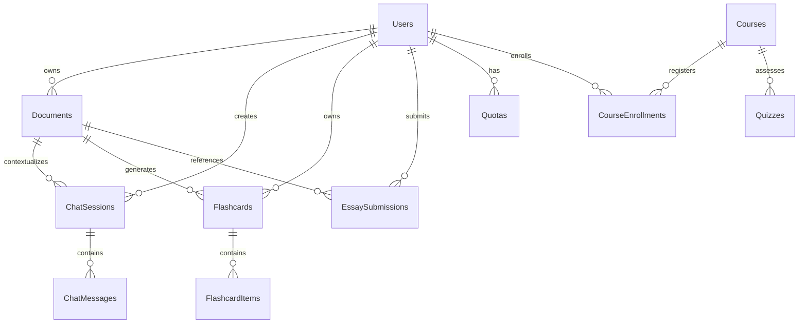

# Lược Đồ Cơ Sở Dữ Liệu & Mô Hình Thực Thể

> Phiên bản: 2.0 | Cập nhật lần cuối: 14/09/2026 | Phụ trách: Platform Team | Trạng thái: Chính thức (Active)

---

## 1. Kiến Trúc Đa Cơ Sở Dữ Liệu

Nền tảng áp dụng mô hình **lưu trữ đa dạng (polyglot persistence)**: PostgreSQL đóng vai trò hệ thống lưu trữ chính cho dữ liệu có cấu trúc, trong khi Qdrant đảm nhiệm lưu trữ và tìm kiếm vector ngữ nghĩa tốc độ cao.

| Nhóm dữ liệu | Hệ thống lưu trữ | Mục đích | Tính nhất quán dữ liệu |
|---|---|---|---|
| **Người dùng, Khóa học, Ghi danh** | PostgreSQL 14 | Bản ghi nghiệp vụ giao dịch cốt lõi | ACID |
| **Nhật ký Chat AI & Kết quả Agent** | PostgreSQL 14 | Nhật ký kiểm toán & lịch sử người dùng | ACID |
| **Đoạn văn bản & Vector nhúng (Embeddings)** | Qdrant (`document_chunks`) | Tìm kiếm ngữ nghĩa theo ngữ cảnh | Nhất quán cuối cùng (Eventually consistent) |

---

## 2. Mô Hình Quan Hệ Thực Thể PostgreSQL (ERD)



Quy ước vòng đời dữ liệu:
- Các thực thể cốt lõi dùng khóa chính **UUIDv4** (`gen_random_uuid()`).
- Cô lập dữ liệu theo người dùng (multi-tenancy) qua khóa ngoại `user_id UUID REFERENCES users(id) ON DELETE CASCADE`.
- Các trường trạng thái chuẩn hóa bằng giá trị cố định, tránh bản ghi `NULL`:
  - `documents.status ∈ {pending, processing, ready, failed}`
  - `chat_messages.role ∈ {user, assistant, system}`
  - `users.role ∈ {student, lecturer, admin}` (một số hệ thống ánh xạ tương đương người dùng chuẩn / giảng viên / quản trị)

---

## 3. Tham Chiếu Các Bảng Cốt Lõi (PostgreSQL)

### 3.1. Định Danh Người Dùng & Phân Quyền

| Bảng | Các cột chính | Mô tả |
|---|---|---|
| `users` | `id` (UUID PK), `email` (UNIQUE), `password_hash`, `full_name`, `avatar_url`, `role`, `is_active` (BOOL), `token_version` (INT), `reset_token`, `oauth_provider`, `created_at` | Thông tin đăng nhập, quyền hạn vai trò và liên kết OAuth |
| `social_accounts` | `id`, `user_id` (FK), `provider`, `provider_user_id`, `access_token_ref` | Liên kết tài khoản mạng xã hội (Google, Facebook) |

### 3.2. Tài Liệu & Trạng Thái Nạp Dữ Liệu

| Bảng | Các cột chính | Mô tả |
|---|---|---|
| `documents` | `id` (UUID PK), `user_id` (FK), `file_name`, `file_type` (pdf/docx/mp3/mp4/txt), `file_url`, `storage_key`, `file_size`, `status` (mặc định `'pending'`), `page_count`, `duration_seconds`, `metadata` (JSONB), `created_at` | Tài liệu nguồn và trạng thái xử lý của Worker. `storage_key` ánh xạ tới đường dẫn đối tượng trên MinIO |
| `notes` | `id`, `user_id` (FK), `document_id` (FK), `content` (TEXT), `created_at` | Ghi chú Markdown & đoạn đánh dấu gắn với tài liệu nguồn |

### 3.3. Bộ Nhớ Hội Thoại AI

| Bảng | Các cột chính | Mô tả |
|---|---|---|
| `chat_sessions` | `id` (UUID PK), `user_id` (FK), `document_id` (FK, nullable), `course_id` (FK, nullable), `title`, `created_at` | Phiên hội thoại có thể gắn phạm vi theo tài liệu hoặc bài học trong khóa học |
| `chat_messages` | `id` (UUID PK), `session_id` (FK), `role` (user/assistant), `content` (TEXT), `citations` (JSONB), `token_usage` (JSONB: prompt/completion), `created_at` | Lịch sử tin nhắn theo từng lượt kèm trích dẫn nguồn |

### 3.4. Công Cụ Học Tập & Đánh Giá

| Bảng | Các cột chính | Mô tả |
|---|---|---|
| `flashcards` | `id` (UUID PK), `user_id` (FK), `document_id` (FK, nullable), `set_name`, `created_at` | Bộ thẻ ghi nhớ được sinh bởi AI RAG |
| `flashcard_items` | `id` (UUID PK), `flashcard_id` (FK), `front_text` (TEXT), `back_text` (TEXT), `last_reviewed`, `review_count` | Từng thẻ ôn tập mặt trước / mặt sau |
| `essay_submissions` | `id` (UUID PK), `user_id` (FK), `document_id` (FK), `submission_text` (TEXT), `ai_score` (NUMERIC 5,2), `ai_feedback` (TEXT), `source_alignments` (JSONB), `submitted_at` | Bài tự luận của học viên và kết quả chấm điểm / đối chiếu từ LLM |
| `quiz_sets` | `id` (UUID PK), `user_id` (FK), `document_id` (FK), `title`, `quiz_type` (quick/detailed), `question_count`, `created_at` | Bộ đề trắc nghiệm do AI sinh kèm dữ liệu câu hỏi |
| `course_quizzes` | `id`, `course_id` (FK), `lesson_id` (FK), `question_items` (JSONB), `explanations` (JSONB) | Bài kiểm tra gắn với khóa học / bài học |

### 3.5. Khóa Học, Thanh Toán & Quản Lý Hạn Mức

| Bảng | Các cột chính | Mô tả |
|---|---|---|
| `quotas` | `id`, `user_id` (FK, UNIQUE), `storage_limit_mb`, `storage_used_mb`, `video_limit`, `video_used`, `token_limit`, `token_used`, `updated_at` | Sổ cái theo dõi hạn mức tài nguyên của từng người dùng |
| `courses` | `id`, `instructor_id` / `lecturer_id` (FK), `title`, `description`, `price_vnd`, `category_id`, `is_published` / `status`, `rating_avg`, `created_at` | Danh mục khóa học trực tuyến |
| `enrollments` | `id`, `user_id` (FK), `course_id` (FK), `payment_id` (FK), `progress_pct`, `enrolled_at` | Trạng thái ghi danh và tiến độ hoàn thành khóa học |
| `payments` | `id`, `user_id` (FK), `course_id` (FK), `amount_vnd`, `provider` (VNPay/MoMo), `transaction_ref`, `status` | Sổ cái giao dịch thanh toán ghi danh |

---

## 4. Chỉ Mục Tối Ưu Hiệu Năng PostgreSQL

| Bảng | Chỉ mục / Ràng buộc | Cột được đánh chỉ mục | Mục tiêu tối ưu |
|---|---|---|---|
| `users` | `unique_email` (UNIQUE) | `email` | Tra cứu đăng nhập O(1) & kiểm tra xác thực |
| `documents` | `idx_user_status` | `(user_id, status)` | Lọc nhanh thư viện tài liệu theo trạng thái |
| `documents` | `ix_documents_user_id` | `user_id` | Xóa dây chuyền (cascade) theo chủ sở hữu |
| `chat_sessions` | `idx_user_updated` | `(user_id, updated_at DESC)` | Thanh danh sách phiên chat sắp theo thời gian |
| `chat_sessions` | `ix_chat_sessions_document_id` | `document_id` | Lọc phiên chat theo từng tài liệu |
| `chat_messages` | `ix_chat_messages_session_id` | `session_id` | Phân trang lịch sử tin nhắn tuần tự |
| `flashcards` | `ix_flashcards_user_id` | `user_id` | Liệt kê danh sách bộ thẻ của người dùng |
| `flashcard_items` | `ix_flashcard_items_flashcard_id` | `flashcard_id` | Mở rộng chi tiết từng thẻ trong bộ |
| `essay_submissions` | `ix_essay_submissions_user_id` | `user_id` | Lịch sử nộp bài tự luận của học viên |
| `quotas` | `ix_quotas_user_id` (UNIQUE) | `user_id` | Tra cứu & cập nhật nguyên tử (1-1) hạn mức |

---

## 5. Cơ Sở Dữ Liệu Vector Qdrant

### 5.1. Collection: `document_chunks`

**Cấu hình Vector:** 384 chiều · mô hình nhúng `all-MiniLM-L6-v2` · khoảng cách Cosine · lưu payload và chỉ mục trên đĩa (`on_disk`).

| Trường Payload | Kiểu dữ liệu | Loại chỉ mục | Mô tả |
|---|---|---|---|
| `document_id` | `keyword` | Khớp chính xác | UUID tài liệu nguồn (bộ lọc chính) |
| `user_id` | `keyword` | Khớp chính xác | Bộ lọc phân tách theo người dùng (ưu tiên lọc mềm) |
| `text_chunk` / `text` | `text` | Toàn văn (Full-text) | Nội dung đoạn văn bản đã trích xuất |
| `chunk_index` | `integer` | Khoảng giá trị | Thứ tự tuần tự của đoạn trong tài liệu |
| `page_number` | `integer` | Khoảng giá trị | Số trang PDF (tài liệu văn phòng mặc định `1`, media tính theo timestamp) |
| `timestamp_start` | `float` | Khoảng giá trị | Mốc bắt đầu đoạn audio/video (giây) |
| `timestamp_end` | `float` | Khoảng giá trị | Mốc kết thúc đoạn audio/video (giây) |
| `course_id` | `keyword` | Khớp chính xác | Lọc học liệu theo phạm vi khóa học |
| `lesson_id` | `keyword` | Khớp chính xác | Định vị chính xác theo từng bài học |

### 5.2. Ví Dụ Payload Theo Loại Dữ Liệu

**Tài liệu PDF / Office (theo trang):**
```json
{
  "document_id": "6ba7b810-9dad-11d1-80b4-00c04fd430c8",
  "user_id": "550e8400-e29b-41d4-a716-446655440000",
  "text_chunk": "Supervised learning maps labeled input vectors to known output labels through empirical risk minimization...",
  "page_number": 12,
  "chunk_index": 4
}
```

**Video / Audio đã phiên âm (theo mốc thời gian):**
```json
{
  "document_id": "7c9e6679-7425-40de-944b-e07fc1f90ae7",
  "user_id": "550e8400-e29b-41d4-a716-446655440000",
  "text_chunk": "In today's lecture we derive gradient descent for logistic regression...",
  "timestamp_start": 85.5,
  "timestamp_end": 120.0,
  "chunk_index": 15,
  "page_number": 2
}
```

### 5.3. Cấu Hình Truy Xuất Ngữ Nghĩa

```python
# src/ai/src/agents/retriever.py
results = qdrant_client.query_points(
    collection_name="document_chunks",
    query=query_vector,                    # Vector đặc trưng 384 chiều
    query_filter=Filter(
        must=[
            FieldCondition(
                key="document_id",
                match=MatchValue(value=str(document_id))
            )
        ]
    ),
    limit=10,
    with_payload=True,
    score_threshold=0.55
)
```

**Chính sách truy xuất (Retrieval Policy):**
1. Thử lọc chặt theo `document_ids AND user_id` (hoặc ưu tiên `lesson_id`, dự phòng sang toàn bộ `course_id` khi ở chế độ khóa học).
2. Nếu không có kết quả khớp, tự động nới lỏng sang chỉ lọc `document_ids` (tránh khác biệt định dạng chuỗi `user_id` khi Worker nạp dữ liệu).
3. Sắp xếp theo độ tương đồng cosine và chuyển qua bước Groq Grader đánh giá độ liên quan.

---

## 6. Vòng Đời & Vận Hành Migration Cơ Sở Dữ Liệu

Toàn bộ thay đổi lược đồ PostgreSQL sử dụng **Alembic migrations**. Thông tin chi tiết về môi trường PostgreSQL cục bộ (Docker) và cloud (Neon Serverless) xem tại [Kiến trúc lưu trữ & bộ nhớ đệm](./storage-and-cache.md#5-cơ-sở-dữ-liệu-quan-hệ-postgresql-neon-và-docker).

Khi chạy qua Docker Compose (từ `nhom07-65httt/src/`):
```bash
docker compose --profile tools run --rm migrate
```

Hoặc khi thao tác trực tiếp tại máy phát triển cục bộ:
```bash
# Di chuyển vào thư mục Backend API
cd nhom07-65httt/src/backend

# Tạo file migration mới từ thay đổi mô hình SQLAlchemy
alembic revision --autogenerate -m "add_flashcard_review_fields"

# Áp dụng toàn bộ migration đang chờ
alembic upgrade head

# Hoàn tác 1 phiên bản migration gần nhất (chỉ dùng khi xử lý sự cố)
alembic downgrade -1

# Kiểm tra phiên bản migration hiện tại
alembic current
```

---

## Xem Thêm

- [Thiết kế tổng thể hệ thống](./system-design.md)
- [Giao tiếp liên dịch vụ & Hợp đồng API](./service-communication.md)
- [Quy trình AI Agent & RAG](./ai-agent-workflow.md)
- [Lưu trữ, bộ nhớ đệm & bền vững dữ liệu](./storage-and-cache.md)
