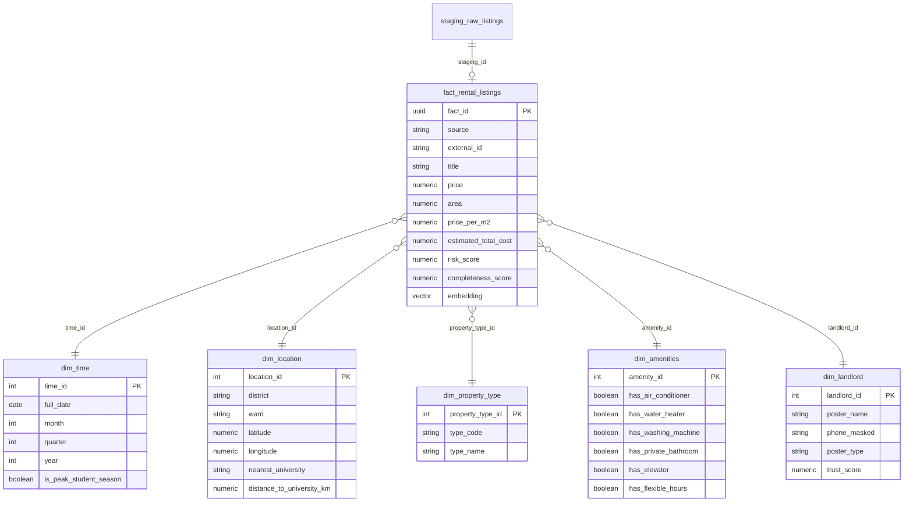

# HỆ THỐNG TÌM KIẾM NHÀ THUÊ THÔNG MINH (HÀ NỘI)
> **Bài tập lớn môn học:** Hệ Thống Kinh Doanh Thông Minh (HTKDTT)  
> **Lớp:** 65HTTT - Trường Đại học Thủy Lợi  
> **Nhóm thực hiện:** Nhóm 12  
> **Giảng viên hướng dẫn:** ThS. Đỗ Oanh Cường  

---

## 1. Giới Thiệu & Mục Tiêu Dự Án

Hệ thống giải quyết bài toán bất cân xứng thông tin, tin đăng mồi ảo, phân mảnh dữ liệu trên thị trường cho thuê phòng trọ, chung cư mini và nhà ở tại Hà Nội.

Dự án tự động hóa quy trình:
1. **Thu thập dữ liệu đa nguồn:** Tự động cào từ Chợ Tốt (Nhà Tốt), Phongtro123 và tích hợp tọa độ địa lý, tiện ích từ OpenStreetMap.
2. **Quy trình ETL & Làm sạch:** Chuẩn hóa đơn vị, loại bỏ trùng lặp, tính toán chỉ số giá/m², ước tính tổng chi phí sinh hoạt hàng tháng (tiền phòng + điện nước + dịch vụ), chấm điểm rủi ro tin mồi câu khách.
3. **Kho Dữ Liệu Star Schema trên Supabase:** Tổ chức CSDL quan hệ theo mô hình Star Schema trên PostgreSQL 17 tích hợp `pgvector` phục vụ Semantic Search & AI Recommendation.
4. **Trực quan hóa & AI:** Phục vụ xây dựng Dashboard trên Apache Superset và Chatbot Text-to-SQL.

---

## 2. Kiến Trúc Kho Dữ Liệu (Star Schema) Trên Supabase

Cơ sở dữ liệu được tổ chức tại dự án Supabase: `NhaThueThongMinh` (`ttcydkbefqiqacygjohj`).



---

## 3. Cấu Trúc Mã Nguồn

```text
nhom12-65httt/
├── docs/                        # Tài liệu dự án
│   └── De_Cuong_HTKDTT.docx     # Đề cương bài tập lớn môn học
├── src/                         # Mã nguồn dự án
│   ├── backend/                 # Backend API, Scraper, ETL & Database
│   │   ├── api/
│   │   │   └── main.py          # FastAPI REST endpoints
│   │   ├── config/
│   │   │   └── settings.py      # Đọc file .env và cấu hình tham số hệ thống
│   │   ├── database/
│   │   │   ├── schema.sql       # Toàn bộ mã nguồn DDL khởi tạo Star Schema
│   │   │   └── supabase_client.py # Client kết nối Supabase chính thức
│   │   ├── scraper/
│   │   │   ├── base_scraper.py  # Abstract Base Class với rate limit, retry
│   │   │   ├── chotot_scraper.py # Crawler API Chợ Tốt Hà Nội
│   │   │   ├── phongtro123_scraper.py # Crawler HTML Phongtro123 Hà Nội
│   │   │   └── osm_service.py   # Geocoding & khoảng cách các trường ĐH (TLU, BKHN...)
│   │   ├── etl/
│   │   │   ├── cleaner.py       # Chuẩn hóa giá, diện tích, phân loại, chấm điểm rủi ro
│   │   │   └── pipeline.py      # Pipeline điều phối nạp Staging & Star Schema
│   │   └── run_pipeline.py      # Script chạy crawler & ETL nạp dữ liệu Supabase
│   └── frontend/                # Ứng dụng Giao diện React (Vite) + Leaflet
│       └── README.md
├── danhsachnhom.md              # Phân công nhiệm vụ các thành viên Nhóm 12
├── README.md                    # Tài liệu hướng dẫn đồ án
├── requirements.txt             # Danh sách gói phụ thuộc Python
├── .env / .env.example          # Cấu hình biến môi trường kết nối Supabase
└── .gitignore                   # Loại trừ .env, tệp tạm, cache khỏi Git
```

---

## 4. Hướng Dẫn Cài Đặt & Sử Dụng

### 4.1. Chuẩn bị môi trường
Yêu cầu máy tính đã cài đặt Python 3.10 trở lên.

```bash
# Di chuyển vào thư mục dự án
cd nhom12-65httt

# Cài đặt các thư viện cần thiết
pip install -r requirements.txt
```

### 4.2. Cấu hình Supabase (.env)
Tạo file `.env` từ file mẫu:
```bash
cp .env.example .env
```
Nội dung file `.env` đã được cấu hình sẵn kết nối tới cơ sở dữ liệu Supabase của dự án.

### 4.3. Khởi chạy Pipeline Cào Dữ Liệu & Lưu Trữ
Bạn có thể chạy thử nghiệm hoặc thu thập số lượng lớn tin đăng:

```bash
# 1. Thu thập tự động tới khi đạt chỉ tiêu (ví dụ 250 tin):
python src/backend/run_pipeline.py --target 250

# 2. Thu thập từ cả 2 nguồn (Chợ Tốt & Phongtro123):
python src/backend/run_pipeline.py --limit 20 --source all

# 3. Thu thập riêng nguồn Chợ Tốt / Nhà Tốt:
python src/backend/run_pipeline.py --limit 50 --source chotot

# 4. Thu thập riêng nguồn Phongtro123:
python src/backend/run_pipeline.py --limit 50 --source phongtro123
```

### 4.4. Truy vấn & Khai thác Dữ liệu trên Supabase
Sau khi chạy pipeline, dữ liệu được tổ chức hoàn chỉnh tại bảng sự kiện và view phân tích:
- Bảng thô: `staging_raw_listings`
- Bảng phân tích: `fact_rental_listings`
- View tổng hợp: `view_rental_market_analytics` (sẵn sàng kết nối Apache Superset hoặc Metabase)
