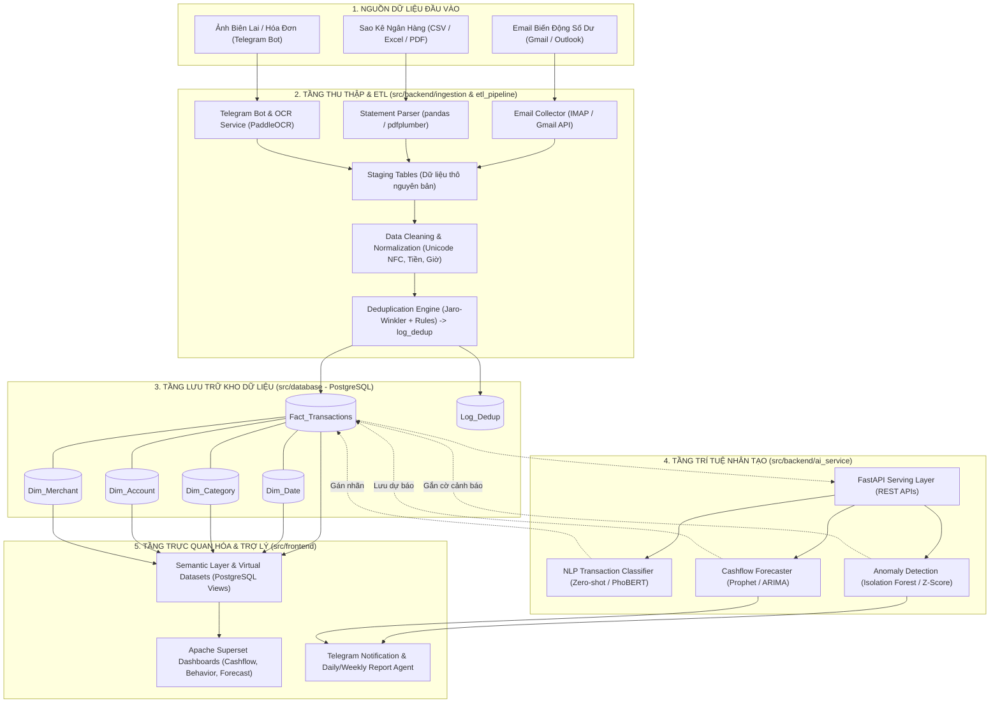

# 02. THIẾT KẾ KIẾN TRÚC HỆ THỐNG

## 1. Sơ Đồ Kiến Trúc Tổng Thể

Hệ thống được thiết kế theo kiến trúc phân tầng độc lập (Layered Architecture) với 5 tầng chức năng chính, đảm bảo nguyên tắc **Tự chủ dữ liệu (Self-hosted)**, **Không xâm phạm (Non-intrusive)** và **Bảo mật tuyệt đối**.

---

## 2. Chi Tiết Các Phân Tầng

### 2.1. Tầng Thu Thập Dữ Liệu Đa Kênh Không Xâm Phạm (Ingestion Layer)
Cơ chế cốt lõi là **không yêu cầu thông tin đăng nhập ngân hàng**, hoàn toàn loại bỏ rủi ro bảo mật:
- **Kênh Email biến động số dư:**
  - Kết nối qua giao thức IMAP an toàn với App Password hoặc Gmail API OAuth2 (quyền chỉ đọc `gmail.readonly`).
  - Định kỳ polling mỗi 15 phút hoặc nhận webhook để quét các email có tiêu đề thông báo thay đổi số dư từ các ngân hàng lớn (VCB, MB, Techcombank, VPBank, TPBank,...).
  - Regex Parser bóc tách: Mã giao dịch, Số tiền, Thời gian, Số dư cuối, Nội dung chuyển khoản.
- **Kênh Tải sao kê định kỳ (CSV / PDF):**
  - Hỗ trợ tải tệp thủ công qua thư mục theo dõi (`watch folder`) hoặc giao diện quản lý.
  - Bộ đọc tệp sử dụng `pandas` (đối với CSV) và `pdfplumber` / `pypdf` (đối với sao kê PDF có cấu trúc dạng bảng).
- **Kênh Ảnh biên lai qua Telegram Bot:**
  - Người dùng chụp hoặc chuyển tiếp ảnh chụp màn hình chuyển khoản/hóa đơn vào Telegram Bot.
  - Bot gọi module OCR (Optical Character Recognition) để nhận diện số tiền, tên người thụ hưởng và thời gian giao dịch.

---

### 2.2. Tầng Tiền Xử Lý, Làm Sạch & Khử Trùng Lặp (ETL & Deduplication Layer)
Pipeline dữ liệu tuân theo kiến trúc 3 bước:

#### Bước 1: Staging (Lưu vết thô)
- Toàn bộ dữ liệu bóc tách được lưu vào các bảng tạm `stg_*` dưới dạng nguyên bản (kèm chuỗi thô và metadata).
- Đảm bảo tính minh bạch, có thể tái xử lý (re-process) nếu phát hiện lỗi bộ bóc tách.

#### Bước 2: Chuẩn hóa dữ liệu (Cleaning & Normalization)
- **Chuẩn hóa số tiền:** Chuyển đổi định dạng dấu chấm/phẩy kiểu Việt Nam (`150.000,00` hoặc `150,000`) về số thực chuẩn `NUMERIC(15, 2)`. Quy ước: Dấu dương ($+$) cho dòng tiền vào, dấu âm ($-$) cho dòng tiền ra.
- **Chuẩn hóa thời gian:** Đồng bộ toàn bộ mốc thời gian về múi giờ chuẩn `Asia/Ho_Chi_Minh` (ISO 8601).
- **Chuẩn hóa chuỗi văn bản:** Làm sạch ký tự lạ, chuyển về Unicode chuẩn NFC, phân tách mã số chuyển khoản tự sinh của ngân hàng ra khỏi nội dung người dùng gõ.

#### Bước 3: Khử trùng lặp đa nguồn (Deduplication Engine)
Tránh hiện tượng ghi nhận 2 lần khi một giao dịch vừa được bắt qua email tức thời vừa có trong sao kê cuối tháng:
1. **Quy tắc 1 (Khớp tuyệt đối):** So sánh `reference_code` (mã giao dịch do ngân hàng cung cấp). Nếu trùng $\rightarrow$ Giữ bản ghi đầy đủ nhất, bỏ bản ghi còn lại.
2. **Quy tắc 2 (Khớp gần đúng - Fuzzy Matching):** Áp dụng khi không có mã tham chiếu hoặc mã bị che:
   - Cùng tài khoản (`account_id`).
   - Cùng số tiền tuyệt đối (`abs(amount)` bằng nhau).
   - Chênh lệch thời gian $|\Delta t| \le 10$ phút.
   - Tên đối tác / nội dung có độ tương đồng Jaro-Winkler hoặc Levenshtein $\ge 0.8$.
3. **Nhật ký xử lý (`log_dedup`):** Mỗi cặp bản ghi bị gộp đều ghi lại ID 2 bản ghi, quy tắc áp dụng và điểm số tương đồng để phục vụ kiểm toán dữ liệu.

---

### 2.3. Tầng Kho Dữ Liệu Phân Tích (Data Warehouse - Star Schema)
Dữ liệu sạch được nạp vào cơ sở dữ liệu quan hệ PostgreSQL theo mô hình Star Schema tối ưu cho truy vấn OLAP:
- **Bảng Fact:** `fact_transactions` lưu toàn bộ dữ liệu định lượng của từng giao dịch.
- **Các bảng Dimension:**
  - `dim_date`: Khai thác thời gian theo các chiều: Ngày, Giờ trong ngày, Thứ trong tuần, Cuối tuần, Tháng, Quý, Năm.
  - `dim_category`: Cấu trúc cây danh mục 2 cấp (Cha - Con), ví dụ: Thiết yếu (Ăn uống, Tiền nhà) - Linh hoạt (Giải trí, Du lịch) kèm hạn mức ngân sách tháng.
  - `dim_account`: Thông tin tài khoản ngân hàng, loại ví, loại tiền tệ.
  - `dim_merchant`: Đơn vị thụ hưởng chuẩn hóa (Shopee, Grab, Highlands Coffee,...).

---

### 2.4. Tầng Xử Lý Trí Tuệ Nhân Tạo (AI Intelligence Layer)
Được đóng gói thành các dịch vụ API độc lập bằng **FastAPI**:
- **NLP Phân loại giao dịch:**
  - Đọc nội dung chuyển khoản tiếng Việt không dấu, viết tắt (ví dụ: `Tien an trua cty`, `tra tien nha t11`).
  - Sử dụng mô hình Machine Learning/NLP (PhoBERT hoặc phân loại Few-shot qua LLM) để tự động gán nhãn `category_id` chuẩn xác.
- **Phát hiện giao dịch bất thường (Anomaly Detection):**
  - Sử dụng thuật toán `Isolation Forest` kết hợp ngưỡng thống kê $Z\text{-score} > 2.5$ tính theo từng danh mục chi tiêu.
  - Gắn cờ `is_anomaly = TRUE` và tạo ghi chú giải thích để gửi cảnh báo.
- **Dự báo dòng tiền (Cashflow Forecasting):**
  - Áp dụng mô hình chuỗi thời gian `Prophet` trên dữ liệu chi tiêu hàng ngày.
  - Dự báo tốc độ đốt tiền (Burn-rate) và số dư tài khoản đến cuối tháng kèm khoảng tin cậy $95\%$.

---

### 2.5. Tầng Trực Quan Hóa Chuẩn Doanh Nghiệp (BI Layer với Apache Superset)
Apache Superset kết nối trực tiếp với PostgreSQL qua kết nối SQL Alchemy an toàn:
- **Tầng ngữ nghĩa (Semantic Layer / Virtual Datasets):** Định nghĩa sẵn các metric dùng chung bằng SQL View (Chi tiêu thực, Tỷ lệ tiết kiệm, Ngân sách còn lại).
- **3 Bảng điều khiển (Dashboards) chuyên sâu:**
  1. *Dashboard 1: Tổng quan Dòng tiền (Cashflow Overview):* Thẻ KPI số dư, Biểu đồ luồng tiền Sankey (Thu nhập $\rightarrow$ Các quỹ chi tiêu $\rightarrow$ Tiết kiệm), Biểu đồ tốc độ đốt tiền Gauge.
  2. *Dashboard 2: Phân tích Hành vi Chi tiêu (Spending Behavior):* Biểu đồ nhiệt Heatmap (Giờ trong ngày $\times$ Ngày trong tuần), Phân tích tỷ trọng danh mục Donut Chart, Chi tiêu theo đơn vị thụ hưởng (Top Merchants).
  3. *Dashboard 3: Dự báo & Cảnh báo AI (AI Forecast & Anomalies):* Đường xu hướng dự báo 30 ngày tới kèm dải cận trên/dưới, Bảng danh sách các giao dịch bất thường cần chú ý.
- **Tự động cảnh báo (Alerts & Reports):** Cấu hình Superset gửi báo cáo tài chính tuần định kỳ qua Telegram/Email.
