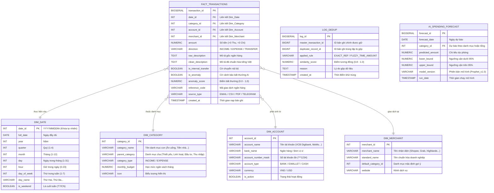

# 04. THIẾT KẾ CƠ SỞ DỮ LIỆU VÀ KHO DỮ LIỆU (STAR SCHEMA)

## 1. Mô Hình Dữ Liệu Tổng Thể (Entity Relationship Diagram)

Hệ thống quản lý dữ liệu tài chính cá nhân được thiết kế theo chuẩn **Kho dữ liệu (Data Warehouse)** sử dụng kiến trúc **Star Schema (Lược đồ hình sao)** trên hệ quản trị cơ sở dữ liệu **PostgreSQL**, tối ưu hóa cho các truy vấn phân tích đa chiều (OLAP) của Apache Superset.



---

## 2. Từ Điển Dữ Liệu Chi Tiết (Data Dictionary)

### 2.1. Bảng Dữ Liệu Fact: `fact_transactions`
Bảng lưu trữ hạt nhân của toàn bộ hệ thống, ghi nhận từng dòng chuyển động tài chính:

| Tên trường | Kiểu dữ liệu | Ràng buộc | Diễn giải nghiệp vụ |
| :--- | :--- | :--- | :--- |
| `transaction_id` | `BIGSERIAL` | `PRIMARY KEY` | Khóa chính tự tăng của giao dịch |
| `date_id` | `INT` | `REFERENCES dim_date(date_id)` | Khóa ngoại thời gian chi tiết theo giờ |
| `category_id` | `INT` | `REFERENCES dim_category(category_id)` | Khóa ngoại danh mục phân loại chi tiêu |
| `account_id` | `INT` | `REFERENCES dim_account(account_id)` | Khóa ngoại tài khoản nguồn/đích |
| `merchant_id` | `INT` | `REFERENCES dim_merchant(merchant_id)` | Khóa ngoại đơn vị thụ hưởng/đối tác |
| `amount` | `NUMERIC(15, 2)` | `NOT NULL` | Số tiền giao dịch: Dương ($>0$) là Thu; Âm ($<0$) là Chi |
| `direction` | `VARCHAR(10)` | `CHECK IN ('INCOME', 'EXPENSE', 'TRANSFER')` | Hướng dòng tiền |
| `raw_description` | `TEXT` | `NOT NULL` | Chuỗi nội dung chuyển khoản gốc từ ngân hàng |
| `clean_description` | `TEXT` | | Chuỗi tiếng Việt đã làm sạch, bỏ mã rác |
| `is_internal_transfer`| `BOOLEAN` | `DEFAULT FALSE` | Cờ đánh dấu giao dịch chuyển tiền qua lại giữa các ví/tài khoản cá nhân |
| `is_anomaly` | `BOOLEAN` | `DEFAULT FALSE` | Cờ cảnh báo bất thường do module AI gán |
| `anomaly_score` | `NUMERIC(5, 4)` | `DEFAULT 0.0` | Điểm bất thường từ thuật toán Isolation Forest ($0.0 \rightarrow 1.0$) |
| `reference_code` | `VARCHAR(100)` | | Mã tham chiếu/mã FT của ngân hàng |
| `source_type` | `VARCHAR(20)` | `NOT NULL` | Kênh thu thập: `EMAIL`, `CSV`, `PDF`, `TELEGRAM` |
| `created_at` | `TIMESTAMP` | `DEFAULT CURRENT_TIMESTAMP` | Thời điểm nạp bản ghi vào kho |

---

### 2.2. Các Bảng Chiều (Dimension Tables)

#### Bảng `dim_date`
Được sinh sẵn trước từ năm 2024 đến 2030, hỗ trợ phân tích đa chiều theo thời gian:
- `date_id` (`INT`): Quy ước định dạng số nguyên `YYYYMMDDHH` (ví dụ `2026112314` đại diện cho 14h ngày 23/11/2026).
- `full_date` (`DATE`): Ngày theo định dạng `2026-11-23`.
- `hour` (`INT`): Khung giờ trong ngày ($0 \rightarrow 23$), phục vụ biểu đồ Heatmap.
- `day_of_week` (`INT`): Thứ trong tuần ($1$ là Chủ Nhật, $2$ là Thứ Hai ... $7$ là Thứ Bảy).
- `is_weekend` (`BOOLEAN`): `TRUE` nếu là Thứ Bảy hoặc Chủ Nhật.

#### Bảng `dim_category`
Phân loại dạng phân cấp 2 cấp giúp tính toán ngân sách và tỷ lệ tiết kiệm ròng:
- `category_id` (`INT PK`): Khóa chính.
- `category_name` (`VARCHAR(100)`): Tên danh mục (ví dụ: Ăn uống, Tiền nhà, Xăng xe, Mua sắm, Đầu tư, Tiết kiệm, Lương thưởng).
- `parent_category` (`VARCHAR(50)`): Nhóm cha (Thiết yếu - Needs, Linh hoạt - Wants, Tiết kiệm/Đầu tư - Savings, Thu nhập - Income).
- `monthly_budget` (`NUMERIC(15, 2)`): Hạn mức ngân sách đề ra hàng tháng cho danh mục này.

#### Bảng `dim_account`
Quản lý các nguồn tiền của người dùng:
- `account_id` (`INT PK`): Khóa chính.
- `account_name` (`VARCHAR(100)`): Tên hiển thị (ví dụ: `Vietcombank - Chi tiêu`, `MB Bank - Lương`, `Ví MoMo`).
- `account_number_mask` (`VARCHAR(20)`): Số tài khoản đã ẩn bớt ký tự nhạy cảm (ví dụ `***9876`).

#### Bảng `dim_merchant`
Chuẩn hóa đơn vị cung cấp dịch vụ hoặc đối tác nhận tiền:
- `merchant_id` (`INT PK`): Khóa chính.
- `merchant_name` (`VARCHAR(150)`): Tên nhận diện (Shopee, Grab, Highlands Coffee, Circle K,...).
- `standard_name` (`VARCHAR(150)`): Tên pháp nhân kinh doanh chuẩn hóa.

---

### 2.3. Bảng Kiểm Soát Khử Trùng: `log_dedup`
Ghi nhận toàn bộ vết lịch sử khi hệ thống phát hiện giao dịch trùng lặp:
- `log_id` (`BIGSERIAL PK`): Mã nhật ký.
- `master_transaction_id` (`BIGINT`): ID bản ghi được lựa chọn giữ lại trong kho.
- `duplicate_record_id` (`BIGINT`): ID bản ghi bị loại bỏ do trùng lặp.
- `applied_rule` (`VARCHAR(50)`): Tên quy tắc khử trùng (`EXACT_REF` hoặc `FUZZY_MATCH`).
- `similarity_score` (`NUMERIC(5, 4)`): Điểm số tương đồng theo thuật toán Jaro-Winkler / Levenshtein.
- `reason` (`TEXT`): Mô tả chi tiết lý do gộp dữ liệu.

---

## 3. Tầng Tạm (Staging Area) Trong Quá Trình ETL

Nhằm phục vụ truy vết khi có sai sót nguồn dữ liệu, các bảng Staging lưu trữ dữ liệu thô:
- `stg_raw_emails`: Lưu email thô (message_id, sender, subject, body_html, received_time, raw_text).
- `stg_raw_statements`: Lưu từng dòng dữ liệu đọc từ file CSV/PDF trước khi chuyển hóa kiểu dữ liệu.
- `stg_raw_receipts`: Lưu thông tin ảnh chụp biên lai Telegram kèm chuỗi văn bản bóc tách từ OCR.

---

## 4. Tầng Ngữ Nghĩa Phục Vụ Apache Superset (Semantic Layer Views)

Được định nghĩa dưới dạng các **SQL Views** trong PostgreSQL để Apache Superset kết nối trực tiếp, đảm bảo toàn bộ công thức tính toán chỉ cần định nghĩa tại một nơi duy nhất:

### 4.1. View Dữ Liệu Sạch Phân Tích: `vw_clean_transactions`
Loại bỏ giao dịch chuyển tiền nội bộ để tính toán chính xác dòng tiền thu/chi thực tế:
```sql
CREATE OR REPLACE VIEW vw_clean_transactions AS
SELECT 
    f.transaction_id,
    f.amount,
    ABS(f.amount) AS abs_amount,
    f.direction,
    f.clean_description,
    f.is_anomaly,
    f.anomaly_score,
    d.full_date,
    d.year,
    d.month,
    d.day,
    d.hour,
    d.day_name,
    d.is_weekend,
    c.category_name,
    c.parent_category,
    c.monthly_budget,
    a.account_name,
    a.bank_name,
    m.merchant_name
FROM fact_transactions f
JOIN dim_date d ON f.date_id = d.date_id
JOIN dim_category c ON f.category_id = c.category_id
JOIN dim_account a ON f.account_id = a.account_id
LEFT JOIN dim_merchant m ON f.merchant_id = m.merchant_id
WHERE f.is_internal_transfer = FALSE;
```

### 4.2. View Tính Tỷ Lệ Tiết Kiệm Ròng: `vw_monthly_savings_rate`
Trả lời trực tiếp câu hỏi nghiệp vụ 1:
```sql
CREATE OR REPLACE VIEW vw_monthly_savings_rate AS
SELECT 
    year,
    month,
    SUM(CASE WHEN direction = 'INCOME' THEN amount ELSE 0 END) AS total_income,
    SUM(CASE WHEN direction = 'EXPENSE' THEN ABS(amount) ELSE 0 END) AS total_expense,
    (SUM(CASE WHEN direction = 'INCOME' THEN amount ELSE 0 END) - 
     SUM(CASE WHEN direction = 'EXPENSE' THEN ABS(amount) ELSE 0 END)) AS net_savings,
    ROUND(
        (SUM(CASE WHEN direction = 'INCOME' THEN amount ELSE 0 END) - SUM(CASE WHEN direction = 'EXPENSE' THEN ABS(amount) ELSE 0 END)) * 100.0 /
        NULLIF(SUM(CASE WHEN direction = 'INCOME' THEN amount ELSE 0 END), 0), 2
    ) AS net_savings_rate_pct
FROM vw_clean_transactions
GROUP BY year, month;
```

### 4.3. View Giám Sát Ngân Sách Vượt Trần: `vw_category_budget_monitoring`
Trả lời câu hỏi nghiệp vụ 2:
```sql
CREATE OR REPLACE VIEW vw_category_budget_monitoring AS
SELECT 
    year,
    month,
    parent_category,
    category_name,
    monthly_budget,
    SUM(abs_amount) AS actual_spent,
    (SUM(abs_amount) - monthly_budget) AS over_budget_amount,
    ROUND((SUM(abs_amount) - monthly_budget) * 100.0 / NULLIF(monthly_budget, 0), 2) AS over_budget_pct
FROM vw_clean_transactions
WHERE direction = 'EXPENSE'
GROUP BY year, month, parent_category, category_name, monthly_budget;
```

### 4.4. View Bản Đồ Nhiệt Chi Tiêu: `vw_spending_heatmap`
Trả lời câu hỏi nghiệp vụ 3 (Khung giờ & Thứ trong tuần):
```sql
CREATE OR REPLACE VIEW vw_spending_heatmap AS
SELECT 
    day_name,
    hour,
    COUNT(transaction_id) AS transaction_count,
    SUM(abs_amount) AS total_spending,
    ROUND(AVG(abs_amount), 0) AS avg_spending_per_trans
FROM vw_clean_transactions
WHERE direction = 'EXPENSE'
GROUP BY day_name, hour;
```

---

## 5. Chiến Lược Đánh Chỉ Mục Tối Ưu (Indexing Strategy)

Để đảm bảo thời gian tải và lọc chéo của Apache Superset đạt tiêu chuẩn $\le 2$ giây:
1. **Chỉ mục kết hợp phân tích thời gian:**
   ```sql
   CREATE INDEX idx_fact_date_category ON fact_transactions(date_id, category_id);
   ```
2. **Chỉ mục lọc giao dịch bất thường:**
   ```sql
   CREATE INDEX idx_fact_anomaly ON fact_transactions(is_anomaly) WHERE is_anomaly = TRUE;
   ```
3. **Chỉ mục tìm kiếm khử trùng lặp:**
   ```sql
   CREATE INDEX idx_fact_ref_code ON fact_transactions(reference_code);
   CREATE INDEX idx_fact_dedup_lookup ON fact_transactions(account_id, amount);
   ```
