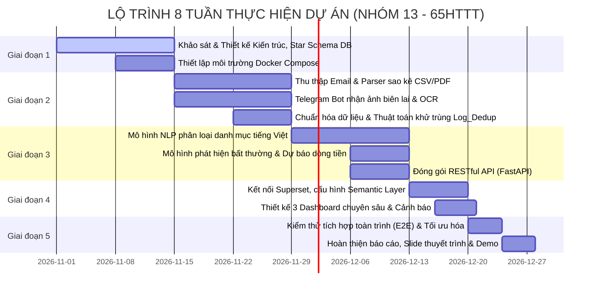

# 05. KẾ HOẠCH TRIỂN KHAI CHI TIẾT VÀ PHÂN CÔNG NHIỆM VỤ

## 1. Lộ Trình Triển Khai Tổng Thể (8 Tuần)

Dự án được thực hiện trong thời gian 8 tuần, chia làm 5 giai đoạn chính theo đúng đề cương học phần Hệ thống Kinh doanh Thông minh (HTKDTM):

---

## 2. Kế Hoạch Chi Tiết Từng Giai Đoạn

### Giai đoạn 1 (Tuần 1 - Tuần 2): Khảo sát, Thiết kế Kiến trúc & Cơ sở dữ liệu
- **Mục tiêu:** Thống nhất kiến trúc tổng thể, mô hình dữ liệu Star Schema trên PostgreSQL, và khởi dựng thành công cụm container Docker.
- **Nội dung công việc:**
  - Thu thập tập dữ liệu mẫu thật/giả lập (email biến động số dư, sao kê ngân hàng VCB, MB, Techcombank, ảnh biên lai chuyển khoản).
  - Viết file `docker-compose.yml` tích hợp: PostgreSQL 15, FastAPI, Apache Superset, Redis.
  - Viết scripts SQL tạo schema: `01_staging.sql`, `02_warehouse_star_schema.sql`, `03_dedup_and_logs.sql`.
  - Sinh bộ dữ liệu giả lập ban đầu (500–1.000 giao dịch) phục vụ dev test.
- **Sản phẩm bàn giao (Deliverables):**
  - Tài liệu đặc tả kiến trúc và tài liệu thiết kế database trong `docs/`.
  - File `docker-compose.yml` khởi chạy thành công các container không bị xung đột cổng.
  - Database schema hoạt động ổn định trên PostgreSQL cục bộ.

---

### Giai đoạn 2 (Tuần 3 - Tuần 4): Xây dựng Hệ thống Thu thập Dữ liệu (ETL Pipeline)
- **Mục tiêu:** Xây dựng xong luồng thu thập dữ liệu đa kênh, làm sạch và khử trùng lặp hoàn toàn tự động.
- **Nội dung công việc:**
  - Viết module kết nối Gmail API / IMAP, bóc tách Regex mẫu email của 3 ngân hàng phổ biến.
  - Viết module đọc file sao kê CSV/PDF chuẩn hóa cấu trúc cột.
  - Xây dựng Telegram Bot nhận ảnh biên lai, tích hợp OCR (Tesseract / PaddleOCR) trích xuất số tiền và đối tác.
  - Xây dựng động cơ khử trùng lặp (Deduplication Engine) áp dụng luật so khớp mã tham chiếu và so khớp gần đúng (Jaro-Winkler/Levenshtein $\ge 0.8$, chênh lệch thời gian $\le 10$ phút). Ghi nhật ký vào `log_dedup`.
  - Thiết lập Scheduler chạy tự động hàng ngày/hàng giờ.
- **Sản phẩm bàn giao:**
  - Toàn bộ source code trong `src/backend/ingestion/` và `src/backend/etl_pipeline/`.
  - Bộ dữ liệu sạch tối thiểu 500–1.000 bản ghi nạp thành công vào `fact_transactions`.

---

### Giai đoạn 3 (Tuần 5 - Tuần 6): Phát triển & Tích hợp Mô hình AI
- **Mục tiêu:** Đóng gói xong các mô hình AI thành API phục vụ phân loại danh mục, phát hiện giao dịch bất thường và dự báo dòng tiền.
- **Nội dung công việc:**
  - **Module NLP:** Xây dựng mô hình phân loại giao dịch từ nội dung chuyển khoản tiếng Việt không dấu/viết tắt (đạt F1-Score $\ge 85\%$).
  - **Module Phát hiện bất thường:** Triển khai thuật toán Isolation Forest kết hợp Z-Score ($> 2.5\sigma$) để đánh dấu cờ `is_anomaly`.
  - **Module Dự báo dòng tiền:** Triển khai mô hình chuỗi thời gian Prophet/ARIMA dự phóng chi tiêu 30 ngày tới và tính Burn-rate (sai số MAPE $< 15\%$).
  - Đóng gói toàn bộ thành RESTful API sử dụng FastAPI (Swagger UI tại `/docs`).
- **Sản phẩm bàn giao:**
  - Source code mô hình trong `src/backend/ai_service/` và `src/backend/api/`.
  - Báo cáo đánh giá độ chính xác của mô hình kèm ma trận nhầm lẫn (Confusion Matrix).

---

### Giai đoạn 4 (Tuần 7): Thiết kế Dashboard trên Apache Superset
- **Mục tiêu:** Hoàn thiện 3 Dashboard trực quan hóa đáp ứng 5 câu hỏi nghiệp vụ và cấu hình cảnh báo tự động.
- **Nội dung công việc:**
  - Kết nối Superset vào PostgreSQL, khai báo các Virtual Datasets thông qua các SQL Views ở tầng Semantic.
  - Thiết kế **Dashboard 1: Tổng quan Dòng tiền (Cashflow Overview)**:
    - Thẻ KPI số dư, Thu nhập thực, Chi tiêu thực, Tỷ lệ tiết kiệm ròng.
    - Biểu đồ Sankey Diagram thể hiện dòng tiền từ Thu nhập $\rightarrow$ Quỹ chi tiêu $\rightarrow$ Tiết kiệm.
    - Đồng hồ tốc độ đốt ngân sách (Gauge Chart).
  - Thiết kế **Dashboard 2: Phân tích Hành vi Chi tiêu (Spending Behavior)**:
    - Bản đồ nhiệt Heatmap (Giờ trong ngày $\times$ Ngày trong tuần).
    - Biểu đồ tròn/donut tỷ trọng danh mục chi tiêu, Drill-down danh mục cha $\rightarrow$ con.
    - Biểu đồ cột ngang Top đơn vị thụ hưởng (Merchants).
  - Thiết kế **Dashboard 3: Dự báo & Cảnh báo AI (AI Forecast & Anomalies)**:
    - Biểu đồ đường dự báo chi tiêu 30 ngày tới kèm dải cận tin cậy $95\%$.
    - Bảng chi tiết các giao dịch bất thường cần rà soát lại.
  - Cấu hình gửi Alerts & Reports định kỳ qua Telegram/Email.
- **Sản phẩm bàn giao:**
  - File JSON/ZIP xuất cấu hình 3 Dashboard lưu tại `src/frontend/superset/dashboards_export/`.
  - Ảnh chụp màn hình và video tương tác bộ dashboard.

---

### Giai đoạn 5 (Tuần 8): Kiểm thử Tích hợp, Đánh giá & Báo cáo Cuối kỳ
- **Mục tiêu:** Kiểm thử toàn trình End-to-End, hoàn thiện tài liệu, slide và sẵn sàng bảo vệ đồ án.
- **Nội dung công việc:**
  - Kiểm thử toàn trình (E2E): Giả lập phát sinh giao dịch mới $\rightarrow$ Email/Telegram nhận $\rightarrow$ ETL làm sạch $\rightarrow$ AI phân loại $\rightarrow$ Nạp kho $\rightarrow$ Superset cập nhật trong $\le 24$h (hoặc tức thời).
  - Đánh giá kiểm tra 50 dòng ngẫu nhiên khớp $100\%$ sao kê gốc.
  - Tổng hợp mã nguồn lên nhánh `nhom13-65httt` trên GitHub, đảm bảo sạch các file rác.
  - Soạn thảo báo cáo cuối kỳ (Word/PDF) và slide thuyết trình.
  - Chuẩn bị kịch bản demo trực tiếp.
- **Sản phẩm bàn giao:**
  - Toàn bộ source code chuẩn chỉnh trong `src/`.
  - Báo cáo đồ án cuối kỳ hoàn chỉnh trong `docs/`.
  - Slide thuyết trình và kịch bản demo sản phẩm.

---

## 3. Phân Công Nhiệm Vụ 5 Thành Viên & Ma Trận RACI

*Ký hiệu ma trận RACI:*
- **R (Responsible):** Người trực tiếp thực hiện công việc.
- **A (Accountable):** Người chịu trách nhiệm chính về chất lượng sản phẩm bàn giao.
- **C (Consulted):** Người được tham vấn chuyên môn, phối hợp kỹ thuật.
- **I (Informed):** Người được thông báo tiến độ và kết quả.

| Thành viên | Vai trò | Nhiệm vụ chính phụ trách | Sản phẩm bàn giao cam kết |
| :--- | :--- | :--- | :--- |
| **1. Thiệu Quang Gia Bảo** | **Nhóm trưởng** | - Điều phối tiến độ chung, quản trị nhánh GitHub `nhom13-65httt`. - Thiết kế kiến trúc tổng thể, mô hình Star Schema trên PostgreSQL. - Thiết lập môi trường Docker Compose (DB, FastAPI, Superset). - Tích hợp các module và tổng hợp báo cáo cuối kỳ. | - Kiến trúc tổng thể & file SQL schema. - File `docker-compose.yml` hoàn chỉnh. - Nhánh Git đồng bộ, báo cáo tổng hợp. |
| **2. Trần Minh Giang** | **Thành viên** | - Xây dựng module thu thập biến động số dư qua Email (IMAP/Gmail API). - Xây dựng parser bóc tách sao kê ngân hàng định dạng CSV và PDF. - Cấu hình scheduler lập lịch chạy tự động pipeline thu thập. | - Code module `email_collector/` & `statement_parser/`. - Bộ trích xuất chuẩn 3 ngân hàng. - Kịch bản lập lịch chạy batch. |
| **3. Nguyễn Thu Giang** | **Thành viên** | - Xây dựng luồng tiếp nhận ảnh biên lai qua Telegram Bot. - Tích hợp OCR (PaddleOCR/Tesseract) bóc tách dữ liệu từ ảnh. - Xây dựng bộ chuẩn hóa dữ liệu (Unicode NFC, số tiền, ngày giờ). - Thuật toán khử trùng lặp đa kênh & nhật ký `log_dedup`. | - Code Telegram Bot & OCR service. - Module chuẩn hóa & khử trùng lặp dữ liệu. - Nhật ký `log_dedup` ghi nhận chính xác 100%. |
| **4. Trương Quốc Thái** | **Thành viên** | - Xây dựng mô hình NLP phân loại danh mục từ mô tả tiếng Việt. - Xây dựng thuật toán phát hiện giao dịch bất thường (Isolation Forest/Z-score). - Xây dựng mô hình chuỗi thời gian dự báo dòng tiền 30 ngày (Prophet). - Đóng gói dịch vụ RESTful API bằng FastAPI. | - Code module `ai_service/` và FastAPI router. - API phân loại/dự báo/cảnh báo sẵn sàng. - Báo cáo đánh giá F1 $\ge 85\%$, MAPE $< 15\%$. |
| **5. Nguyễn Thị Khanh** | **Thành viên** | - Kết nối cơ sở dữ liệu PostgreSQL vào Apache Superset. - Thiết kế tầng ngữ nghĩa (Semantic Layer / Views), Virtual Datasets. - Thiết kế 3 Dashboards hoàn chỉnh (Cashflow, Behavior, AI Forecast). - Thiết lập Alerts & Reports tự động; chuẩn bị slide và demo. | - 3 Dashboards Superset xuất file JSON. - Cấu hình thông báo Telegram tự động. - Slide thuyết trình và kịch bản demo trực tiếp. |

### Ma Trận RACI Chi Tiết

| Hạng mục công việc | Thiệu Quang Gia Bảo | Trần Minh Giang | Nguyễn Thu Giang | Trương Quốc Thái | Nguyễn Thị Khanh |
| :--- | :---: | :---: | :---: | :---: | :---: |
| 1. Thiết kế Star Schema & Docker Compose | **A / R** | C | C | C | C |
| 2. Thu thập Email & Sao kê CSV/PDF | A | **R** | C | I | I |
| 3. Telegram Bot OCR & Khử trùng lặp (Dedup) | A | C | **R** | I | I |
| 4. Xây dựng AI (NLP, Anomaly, Prophet) & API | A | I | I | **R** | C |
| 5. Thiết kế Superset Dashboards & Semantic Views | A | I | I | C | **R** |
| 6. Kiểm thử E2E & Tích hợp hệ thống | **A / R** | R | R | R | R |
| 7. Viết báo cáo cuối kỳ & Chuẩn bị Slide/Demo | **A / R** | C | C | C | **R** |

---

## 4. Quản Lý Rủi Ro & Biện Pháp Giảm Thiểu (Risk Management)

| Rủi ro tiềm ẩn | Mức độ | Biện pháp giảm thiểu & Phương án dự phòng |
| :--- | :---: | :--- |
| **1. Email ngân hàng thay đổi cấu trúc/mẫu** | Trung bình | Tách riêng các regex parser thành từng file cấu hình độc lập; lưu dữ liệu thô vào `stg_raw_emails` để có thể re-parse lại bất cứ lúc nào. |
| **2. Ảnh biên lai mờ khiến OCR nhận diện sai** | Trung bình | Bot Telegram phản hồi ảnh xem trước và yêu cầu người dùng bấm nút xác nhận nhanh (Inline Keyboard) nếu độ tin cậy OCR $< 80\%$. |
| **3. Mô hình NLP phân loại sai nội dung viết tắt lạ** | Thấp | Kết hợp bộ luật heuristic từ khóa thông dụng trước khi gọi mô hình NLP; cho phép người dùng sửa danh mục trực tiếp để lưu feedback học thêm. |
| **4. Superset khởi động nặng hoặc xung đột cấu hình** | Thấp | Cấu hình giới hạn RAM/CPU trong Docker Compose; xuất sẵn bản backup JSON Dashboards vào kho Git để import lại nhanh chóng. |
| **5. Xung đột code Git giữa các thành viên** | Trung bình | Phân tách module độc lập trong `src/`; mỗi thành viên phát triển trên nhánh tính năng riêng trước khi merge vào nhánh `nhom13-65httt`. |
