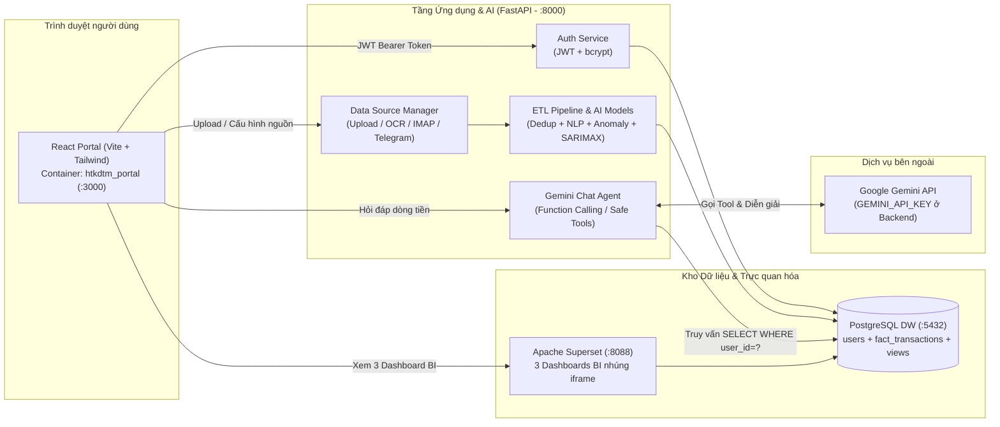

# 08. KẾ HOẠCH NÂNG CẤP PORTAL REACT, ĐA NGƯỜI DÙNG & TRỢ LÝ CHAT AI GEMINI

- **Đề tài:** Hệ thống Quản lý Tài chính Cá nhân Thông minh (Personal Finance Intelligence)
- **Nhóm thực hiện:** `nhom13-65httt`
- **Phạm vi nâng cấp:** Mở rộng từ nền tảng BI & API (Giai đoạn 1–4) thành ứng dụng Web **Personal CFO Portal** hoàn chỉnh chạy trong Docker, hỗ trợ đa tài khoản, tùy chọn kênh thu thập dữ liệu ngân hàng và hỏi đáp dòng tiền bằng dữ liệu thật qua **Gemini API**.

---

## 1. Mục Tiêu Nâng Cấp (Objectives)

1. **Giao diện người dùng hiện đại bằng React (Containerized):**
   - Xây dựng Web Portal bằng **React 18 + Vite + TailwindCSS** đóng gói thành container Docker (`htkdtm_portal`, cổng `3000`), giúp người dùng cuối thao tác tập trung thay vì phải dùng rời rạc Swagger UI và Superset.
2. **Quản lý tài khoản & Cô lập dữ liệu đa người dùng (Multi-user Auth):**
   - Xây dựng chức năng **Đăng ký / Đăng nhập** sử dụng **JWT (JSON Web Token)** và mã hóa mật khẩu bằng `bcrypt`.
   - Cô lập tuyệt đối dữ liệu giao dịch, tài khoản ngân hàng, cấu hình nguồn dữ liệu và lịch sử chat theo từng `user_id`.
3. **Tùy chọn linh hoạt nguồn lấy dữ liệu ngân hàng cá nhân:**
   - Cho phép từng người dùng chủ động lựa chọn và cấu hình phương thức thu thập dữ liệu phù hợp:
     - Tải lên sao kê **Excel (`.xlsx`), CSV, PDF** (kéo-thả trực tiếp trên Web).
     - Quét ảnh chụp hóa đơn / biên lai bằng **Tesseract OCR tiếng Việt**.
     - Cấu hình kết nối **Email biến động số dư (IMAP Read-only)** với mật khẩu ứng dụng được mã hóa an toàn.
     - Kết nối **Telegram Bot** cá nhân.
4. **Trợ lý Chat AI Gemini hỏi đáp trên dữ liệu thật (Zero Hallucination):**
   - Tích hợp **Gemini API** (đọc `GEMINI_API_KEY` từ `.env` phía Backend) kết hợp cơ chế **Function Calling (Tool Use)** truy vấn trực tiếp kho dữ liệu PostgreSQL của đúng người dùng đang đăng nhập.
   - Đảm bảo mọi câu hỏi thực tế (ví dụ: *"Kiểm tra giúp tôi trong tháng 10 vừa rồi 5 nguồn tiền gửi đi nhiều nhất"*) được PostgreSQL tính toán chính xác **100%** (tên đối tác, số tài khoản đã che, số lần chuyển, tổng số tiền), sau đó Gemini diễn giải tự nhiên kèm bảng dữ liệu trực quan.
5. **Giữ trọn vẹn thế mạnh BI của Apache Superset:**
   - Nhúng trực tiếp **3 Dashboard Apache Superset** (Cashflow Overview, Spending Behavior, AI Forecast & Anomalies) ngay trong giao diện React Portal.

---

## 2. Kiến Trúc Hệ Thống Sau Khi Nâng Cấp



### Luồng xử lý Chat AI Gemini đảm bảo chính xác 100% số liệu
1. Người dùng gõ câu hỏi trên React: *"Tháng 10 vừa rồi 5 tài khoản nhận tiền từ tôi nhiều nhất là những ai?"*
2. React gửi `POST /api/v1/chat/ask` kèm JWT Token lên FastAPI Backend.
3. Backend xác thực `user_id`, chuyển câu hỏi cho **Gemini API** kèm định nghĩa các công cụ (Tools) truy vấn dữ liệu.
4. Gemini tự động chọn gọi tool `get_top_recipients(year=2026, month=10, limit=5)`.
5. Backend thực thi câu SQL tham số hóa trên PostgreSQL (ép cứng `WHERE user_id = :current_user_id AND direction = 'EXPENSE'`), lấy chính xác Top 5 đối tác + số tài khoản đã che (`****8868`) + tổng số tiền + số lượt chuyển.
6. Backend gửi bảng kết quả thật về cho Gemini để viết câu trả lời tiếng Việt rõ ràng, đồng thời trả kèm `structured_data` để React hiển thị bảng đối chiếu ngay trong khung chat.

---

## 3. Kế Hoạch Mở Rộng Cơ Sở Dữ Liệu (`05_multi_user_and_chat.sql`)

### 3.1. Các bảng mới bổ sung
| Tên bảng | Các cột chính | Mục đích |
| :--- | :--- | :--- |
| **`users`** | `user_id (PK)`, `email (UNIQUE)`, `password_hash`, `full_name`, `is_active`, `created_at` | Lưu thông tin tài khoản người dùng (mật khẩu hash bằng `bcrypt`). |
| **`user_data_sources`** | `source_id (PK)`, `user_id (FK)`, `source_type`, `display_name`, `config_encrypted`, `is_enabled`, `last_sync_at` | Lưu cấu hình kênh lấy dữ liệu riêng của từng người dùng (CSV/Excel/PDF, IMAP mã hóa Fernet, Telegram Bot). |
| **`chat_messages`** | `message_id (PK)`, `user_id (FK)`, `session_id`, `role ('user'/'assistant')`, `content`, `structured_data (JSONB)`, `created_at` | Lưu lịch sử hội thoại Chat AI theo từng người dùng. |

### 3.2. Nâng cấp các bảng hiện có
- **`fact_transactions`:**
  - Thêm cột `user_id INT NOT NULL DEFAULT 1 REFERENCES users(user_id)`.
  - Thêm cột `counterparty_name VARCHAR(200)` (tên cá nhân/đơn vị thụ hưởng hoặc người chuyển trích trực tiếp từ sao kê/email).
  - Thêm cột `counterparty_account_mask VARCHAR(50)` (số tài khoản đối tác đã che ẩn dạng `****8868` để vừa nhận diện chính xác từng tài khoản nhận tiền vừa bảo vệ quyền riêng tư).
  - Thêm cột `counterparty_bank VARCHAR(100)` (ngân hàng đối tác, ví dụ `MB`, `ACB`, `VIETCOMBANK`).
- **`dim_account`, `ai_spending_forecast`, `log_dedup`:** Bổ sung cột `user_id INT NOT NULL DEFAULT 1 REFERENCES users(user_id)` và đánh chỉ mục `idx_fact_user_date (user_id, date_id)`.
- **Cập nhật View `vw_clean_transactions`:** Bổ sung `user_id`, `counterparty_name`, `counterparty_account_mask`, `counterparty_bank` để phục vụ đồng bộ cả Superset lẫn Chat AI.
- **Tài khoản Demo mặc định (`user_id = 1`):** Tự động tạo tài khoản `demo@finance.local` / `Demo@123` gắn với toàn bộ 776 giao dịch hiện có để sẵn sàng demo ngay lập tức.

---

## 4. Kế Hoạch Nâng Cấp Backend FastAPI (`src/backend/`)

### 4.1. Thư viện bổ sung (`requirements.txt`)
- `google-genai>=1.0.0`: SDK chính thức mới nhất gọi Google Gemini API (hỗ trợ Function Calling mượt mà).
- `PyJWT>=2.8.0`, `passlib[bcrypt]>=1.7.4`, `bcrypt>=4.0.1,<5.0.0`: Xác thực JWT & mã hóa mật khẩu.
- `cryptography` (đã có sẵn): Mã hóa đối xứng `Fernet` cho mật khẩu ứng dụng IMAP/Token cấu hình của từng user.

### 4.2. Các Module & API mới

#### A. Xác thực người dùng (`api/security.py`, `api/routers/auth_routes.py`)
| Method | Endpoint | Chức năng |
| :---: | :--- | :--- |
| `POST` | `/api/v1/auth/register` | Tạo tài khoản mới (email, mật khẩu, họ tên) + tự động khởi tạo ví mặc định |
| `POST` | `/api/v1/auth/login` | Xác thực và cấp JWT Access Token (`Bearer`) |
| `GET` | `/api/v1/auth/me` | Lấy thông tin người dùng hiện tại |

#### B. Quản lý nguồn dữ liệu linh hoạt (`api/routers/sources_routes.py` & cập nhật `ingestion_routes.py`)
| Method | Endpoint | Chức năng |
| :---: | :--- | :--- |
| `GET` | `/api/v1/sources` | Xem danh sách phương thức thu thập đang bật/tắt và lịch sử nạp gần nhất của user |
| `POST` | `/api/v1/sources/configure` | Lưu cấu hình kênh dữ liệu tự chọn (IMAP Gmail mã hóa, Telegram Chat ID, hoặc chế độ Upload thủ công) |
| `POST` | `/api/v1/ingestion/upload-statement` | *(Cập nhật)* Gắn `user_id` từ JWT, trích tách đầy đủ `counterparty_name` & `counterparty_account_mask` |
| `POST` | `/api/v1/ingestion/ingest-receipt-image` | *(Cập nhật)* Tải ảnh hóa đơn OCR gắn theo `user_id` đang đăng nhập |

#### C. Trợ lý Chat AI Gemini (`ai_service/chat_agent/gemini_agent.py`, `api/routers/chat_routes.py`)
| Method | Endpoint | Chức năng |
| :---: | :--- | :--- |
| `POST` | `/api/v1/chat/ask` | Gửi câu hỏi tiếng Việt $\rightarrow$ Gemini Function Calling truy vấn dữ liệu thật của user $\rightarrow$ trả lời kèm bảng dữ liệu |
| `GET` | `/api/v1/chat/history` | Lấy lịch sử các câu hỏi & câu trả lời gần nhất của user |
| `DELETE` | `/api/v1/chat/history` | Xóa lịch sử hội thoại để bắt đầu phiên hỏi đáp mới |

**Danh sách 7 Tool dữ liệu thật cung cấp cho Gemini Agent:**
1. `get_top_recipients(year, month, limit=5)`: Top tài khoản / đối tác **nhận tiền từ bạn nhiều nhất** (trả về tên đối tác, số TK đã che, ngân hàng, số lượt chuyển, tổng số tiền).
2. `get_top_senders(year, month, limit=5)`: Top nguồn **chuyển tiền đến cho bạn nhiều nhất**.
3. `get_spending_by_category(year, month)`: Tổng chi tiêu & tỷ lệ vượt ngân sách theo từng danh mục.
4. `get_monthly_cashflow(months=6)`: Tổng thu, tổng chi, tiết kiệm ròng và tỷ lệ tiết kiệm (%) qua các tháng.
5. `get_burn_rate_and_forecast(year, month)`: Tốc độ đốt ngân sách, số dư cuối tháng dự kiến và tổng chi dự báo 30 ngày tới.
6. `get_anomalies(limit=10)`: Danh sách các giao dịch bất thường do AI Isolation Forest + Z-Score cảnh báo.
7. `search_transactions(keyword, year, month, direction, limit=20)`: Tìm kiếm giao dịch chi tiết theo từ khóa, đối tác, ngày tháng hoặc chiều dòng tiền.

---

## 5. Kế Hoạch Xây Dựng Frontend React & Docker (`src/frontend/portal/`)

### 5.1. Công nghệ & Đóng gói Docker
- **Framework:** React 18 + Vite 5 + TailwindCSS 3 + `lucide-react` + `axios` + `react-router-dom`.
- **Docker Container (`htkdtm_portal`):**
  - Multi-stage `Dockerfile`: Stage 1 (`node:20-alpine`) build tĩnh `npm run build`; Stage 2 (`nginx:alpine`) phục vụ ứng dụng tại cổng `3000:80` kèm `nginx.conf` tự động reverse-proxy `/api/*` sang `http://backend:8000` (tránh mọi lỗi CORS).
- **Cấu trúc thư mục `src/frontend/portal/`:**
  ```text
  src/frontend/portal/
  ├── Dockerfile
  ├── nginx.conf
  ├── package.json
  ├── vite.config.js
  ├── tailwind.config.js
  ├── index.html
  └── src/
      ├── main.jsx
      ├── App.jsx
      ├── api/client.js              # Axios instance tự gắn JWT Bearer Token
      ├── context/AuthContext.jsx    # Quản lý phiên đăng nhập / đăng xuất
      ├── components/
      │   ├── Layout.jsx             # Sidebar điều hướng 4 phân hệ + thông tin user
      │   └── DataTablePreview.jsx   # Bảng hiển thị dữ liệu thật trả về từ Chat AI
      └── pages/
          ├── LoginPage.jsx          # Đăng nhập & Đăng ký (có nút Demo nhanh)
          ├── DashboardPage.jsx      # Thẻ KPI theo user + Nhúng 3 Dashboard Superset
          ├── DataSourcesPage.jsx    # Chọn nguồn lấy dữ liệu (Upload, OCR, IMAP, Telegram)
          └── ChatAIPage.jsx         # Giao diện Chat AI Gemini + gợi ý câu hỏi nhanh
  ```

### 5.2. Thiết kế 4 Màn hình Cốt lõi
1. **Đăng nhập / Đăng ký (`/login`):**
   - Chuyển đổi nhanh giữa tab Đăng nhập và Tạo tài khoản mới.
   - Nút *"Dùng tài khoản Demo (`demo@finance.local`)"* giúp giảng viên kiểm thử nhanh chỉ bằng 1 cú nhấp chuột.
2. **Tổng quan & Dashboard BI (`/dashboard`):**
   - Hàng trên cùng: 4 thẻ KPI realtime lọc đúng theo `user_id` hiện tại (Thu nhập tháng, Chi tiêu tháng, Tỷ lệ tiết kiệm ròng, Số dư cuối tháng dự kiến).
   - Bên dưới: Thanh chuyển tab giữa **3 Dashboard Apache Superset** (*Tổng quan Dòng tiền*, *Hành vi Chi tiêu*, *Dự báo & Cảnh báo AI*) nhúng trực tiếp qua `iframe` kèm nút mở toàn màn hình.
3. **Trung tâm Kết nối Nguồn Dữ liệu (`/data-sources`):**
   - 4 thẻ phương thức để người dùng tự chọn:
     - **Tải lên Sao kê (Excel / CSV / PDF):** Khung kéo-thả file, hiển thị tức thì số giao dịch mới nạp, số bản ghi khử trùng lặp và trạng thái 5 luật Data Quality.
     - **Quét Hóa đơn (OCR tiếng Việt):** Tải ảnh biên lai/hóa đơn, xem ngay số tiền và đối tác AI đọc được.
     - **Đồng bộ Email Ngân hàng (IMAP):** Form cấu hình địa chỉ Gmail & App Password (mã hóa Fernet), bật/tắt đồng bộ tự động 15 phút/lần.
     - **Kết nối Bot Telegram:** Nhập Chat ID để nhận cảnh báo bất thường và gửi ảnh hóa đơn từ điện thoại.
   - Khu vực **Tác vụ AI nhanh:** Nút bấm kích hoạt ngay *Phát hiện bất thường* & *Chạy lại dự báo 30 ngày* sau khi user nạp dữ liệu mới.
4. **Trợ lý Chat AI Gemini (`/chat`):**
   - Danh sách nút hỏi nhanh một chạm (bao gồm đúng ví dụ: *"Tháng 10 vừa rồi 5 tài khoản nhận tiền nhiều nhất là ai?"*, *"Tỷ lệ tiết kiệm ròng 6 tháng gần đây?"*, *"Danh mục nào đang vượt ngân sách?"*, *"Có giao dịch bất thường nào cần kiểm tra không?"*).
   - Khung chat hiển thị câu trả lời trực quan từ Gemini kèm **bảng dữ liệu thật trích xuất từ PostgreSQL** và tên Tool AI đã sử dụng (tăng tính minh bạch, giải thích được con số khi bảo vệ đồ án).

---

## 6. Lộ Trình Triển Khai Chi Tiết (5 Bước)

| Bước | Nội dung thực hiện | Sản phẩm đầu ra |
| :---: | :--- | :--- |
| **Bước 1** | Viết migration [05_multi_user_and_chat.sql](file:///d:/HTKDTM/project-htkdtm/nhom13-65httt/src/database/schemas/05_multi_user_and_chat.sql) (bảng `users`, `user_data_sources`, `chat_messages`, thêm `user_id` & `counterparty_*`), nạp lên PostgreSQL, đồng bộ `init_database.sql`, cập nhật ETL lưu đầy đủ đối tác nhận tiền. | Schema đa người dùng + toàn bộ dữ liệu cũ gắn tài khoản Demo + cập nhật đối tác cho 83 dòng sao kê MB Bank thật. |
| **Bước 2** | Nâng cấp Backend FastAPI: Auth JWT (`register`/`login`/`me`), Data Source Manager (mã hóa Fernet), cô lập `user_id` trên mọi API Ingestion, AI và Analytics. | `auth_routes.py`, `sources_routes.py`, `security.py` hoạt động chuẩn JWT. |
| **Bước 3** | Xây dựng Gemini Chat Agent (`google-genai` + 7 Tools truy vấn PostgreSQL chỉ đọc theo `user_id`) + `chat_routes.py`, kiểm thử thực tế với `GEMINI_API_KEY` trong `.env`. | Trợ lý Chat AI trả lời chính xác câu hỏi *"Top 5 nguồn tiền gửi đi nhiều nhất tháng 10"* bằng dữ liệu thật. |
| **Bước 4** | Xây dựng React Frontend (`src/frontend/portal/` với 4 màn hình), tạo `Dockerfile` + `nginx.conf`, thêm container `htkdtm_portal` (`:3000`) vào `docker-compose.yml` và build chạy thử. | Cụm **5 container** chạy mượt (`postgres`, `redis`, `backend`, `superset`, `portal`). |
| **Bước 5** | Kiểm thử toàn trình (E2E): Đăng ký user mới $\rightarrow$ Upload sao kê MB Bank $\rightarrow$ Kiểm tra cô lập dữ liệu giữa User mới và User Demo $\rightarrow$ Chat Gemini hỏi Top 5 tài khoản nhận tiền $\rightarrow$ Xem Dashboard. | Toàn bộ Unit Test & E2E Test đạt 100%, sẵn sàng demo & push GitHub. |

---

## 7. Tiêu Chí Nghiệm Thu & Ràng Buộc Bảo Mật

- [ ] **Cô lập dữ liệu (Data Isolation):** Tài khoản mới đăng ký thấy `0` giao dịch của tài khoản khác; chỉ thấy dữ liệu do chính mình tải lên/đồng bộ.
- [ ] **Bảo mật API Key & Mật khẩu:** `GEMINI_API_KEY` chỉ nằm ở `.env` phía Backend (tuyệt đối không xuất hiện trong mã bundle React); mật khẩu user hash bằng `bcrypt`; mật khẩu IMAP mã hóa bằng `Fernet`.
- [ ] **Độ chính xác Chat AI (Zero Hallucination):** Mọi con số trả lời từ Gemini (tổng tiền, Top 5 tài khoản nhận tiền, tỷ lệ tiết kiệm) phải khớp **100%** với kết quả truy vấn trực tiếp từ PostgreSQL.
- [ ] **Triển khai đồng bộ 1 lệnh:** Toàn bộ hệ thống 5 container khởi chạy đầy đủ bằng `docker compose up -d --build` cho mọi thành viên trong nhóm.
