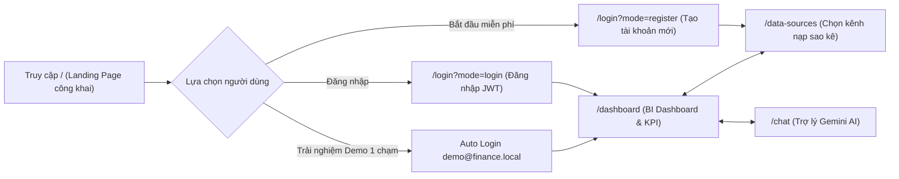

# THIẾT KẾ GIAO DIỆN LANDING PAGE & HỆ THỐNG DESIGN SYSTEM (PHONG CÁCH BRAND ESTONIA)

**Dự án:** Hệ thống Quản lý Tài chính Cá nhân Thông minh tích hợp Thu thập Dữ liệu Tự động, AI phân loại & dự báo, trực quan hóa Apache Superset & Trợ lý Gemini AI  
**Đơn vị thực hiện:** Nhóm 13 — Lớp 65HTTT (Học phần Hệ Thống Kinh Doanh Thông Minh - HTKDTM)  
**Nguồn cảm hứng thiết kế:** [Brand Estonia (`https://brand.estonia.ee/`)](https://brand.estonia.ee/) — Digital Design System (DDS 2.0)  
**Phạm vi áp dụng:** Trang giới thiệu sản phẩm (**Landing Page** tại `/`), màn hình **Đăng nhập / Đăng ký** (`/login`), và chuẩn hóa bộ Design Tokens cho toàn bộ React Portal (`src/frontend/portal/`).

---

## 1. Phân Tích Chuyên Sâu Giao Diện & Hệ Thống Thiết Kế `brand.estonia.ee`

Trang web quốc gia **Brand Estonia** (`brand.estonia.ee`, vận hành bởi Estonian Business and Innovation Agency - EIS) là một trong những chuẩn mực thiết kế số Bắc Âu (*Nordic Digital Design*) tiêu biểu nhất thế giới. Thay vì dựa vào một biểu tượng logo cầu kỳ hay các hiệu ứng 3D rối mắt, Brand Estonia tạo ra bản sắc nhận diện tức thì nhờ **5 trụ cột thiết kế kỷ luật**:

### 1.1. Triết lý thẩm mỹ: "Nordic Digital Clarity & Airy Narrative"
- **Tối giản có chủ đích (Functional Minimalism):** Ưu tiên không gian trắng rộng rãi (*generous whitespace*), bố cục dạng biên tập (*editorial grid*) giúp người đọc quét thông tin kỹ thuật hoặc số liệu phức tạp mà không bị ngợp.
- **Giọng văn (Tone of Voice):** Rõ ràng, thông minh, trung thực và dựa trên bằng chứng thực tế — tránh khẩu hiệu phóng đại. Tinh thần này tương thích tuyệt đối với sản phẩm **Fintech / Personal BI** (nơi niềm tin vào độ chính xác của số liệu là tối thượng).
- **Nhận diện bằng Hệ thống thay vì Logo:** Sự kết hợp chặt chẽ giữa màu xanh dương số (*Estonian Blue*), bảng trung tính đá tảng (*Boulders*), kiểu chữ thoáng (*Aino*), hình khối bất đối xứng (*Rändrahnud*) và đường nét đứt (*Broken Line*).

### 1.2. Hệ thống Màu sắc Chính thức (Nature-Inspired & Boulders Palette)
Brand Estonia sử dụng bảng màu trung tâm **Estonian Blue** (tượng trưng cho bầu trời, biển cả và quốc gia số tiên phong) phối hợp cùng bộ màu xám trung tính mang tên các tảng đá băng hà (**Boulders**):

| Nhóm màu | Tên gốc (Brand Estonia) | Mã HEX | Vai trò gốc trên `brand.estonia.ee` | Ứng dụng vào Personal CFO Portal |
| :--- | :--- | :---: | :--- | :--- |
| **Estonian Blue** | **Estonian Blue** *(Main)* | `#0030DE` | Màu thương hiệu chủ đạo, CTA chính, điểm nhấn số | Nút CTA chính (*Tạo tài khoản*), màu active nav, hiệu ứng Color-Flip khi hover |
| **Estonian Blue** | **Paldiski** *(Secondary)* | `#0062F5` | Xanh dương sáng hơn cho trạng thái tương tác | Trạng thái `:hover` / `:focus` của nút chính, đường line biểu đồ |
| **Estonian Blue** | **Liivi** *(Secondary)* | `#000087` | Xanh chàm đậm tạo khối tương phản sâu | Nền khối nổi bật (*Gemini AI Showcase*), panel trái màn hình Login |
| **Estonian Blue** | **Pärnu** *(Secondary)* | `#CEE2FD` | Xanh băng nhạt cho bề mặt nổi nhẹ | Nền Eyebrow badge, thẻ highlight KPI, khối Boulder trang trí |
| **Estonian Blue** | **Narva** *(Accent)* | `#00C3FF` | Xanh cyan điện tử tạo nhịp hiện đại | Chấm trạng thái live AI, nét đứt (*Broken Line*) trên nền tối |
| **Estonian Blue** | **Haapsalu** *(Accent)* | `#FCEEC8` | Vàng cát ấm cân bằng tông lạnh Bắc Âu | Thẻ khuyến nghị tài chính (*Burn-rate advice*), ghi chú Demo |
| **Boulders** | **Ehakivi** *(White)* | `#FFFFFF` | Nền bề mặt sạch, chữ trên nền xanh/tối | Nền trang chính, nền card *Limestone*, chữ trên nút `#0030DE` |
| **Boulders** | **Pahkla** *(Light Canvas)* | `#F1F5F9` | Nền phân tách các khu vực (*section zebra*) | Nền dải số liệu kiểm chứng, nền các khối phụ |
| **Boulders** | **Hellamaa** *(Border)* | `#CBD5E1` | Đường kẻ mảnh, viền bảng, đường phân cách | Viền card `1px solid`, đường lưới bảng dữ liệu |
| **Boulders** | **Kabelikivi** *(Muted)* | `#64748B` | Chữ phụ, chú thích, nhãn trục biểu đồ | Mô tả phụ, timestamp, caption số liệu |
| **Boulders** | **Majakivi** *(Body Muted)* | `#3D4B5E` | Nội dung đoạn văn phụ, nhãn bảng | Nội dung chi tiết trong card, danh sách tính năng |
| **Boulders** | **Mustkivi** *(Dark Ink)* | `#0F172A` | Chữ tiêu đề chính, nền tối Footer | Toàn bộ Headline trên nền sáng, nút phụ đen, nền Footer |

> **Bổ sung màu ngữ nghĩa Tài chính (Semantic Finance Tokens):** Giữ sắc độ gọn gàng theo tinh thần Bắc Âu để không phá vỡ tông xanh-xám chủ đạo:
> - Thu nhập / An toàn (`Income / Safe`): `#059669` (nền nhạt `#ECFDF5`)
> - Cảnh báo ngân sách (`Warning`): `#D97706` (nền nhạt `#FFFBEB`)
> - Chi tiêu bất thường / Rủi ro (`Anomaly / Danger`): `#E11D48` (nền nhạt `#FFF1F2`)

### 1.3. Hệ thống Kiểu chữ (Typography — Aino & Ánh xạ Tiếng Việt)
- **Nguyên tắc gốc của font `Aino` (Anton Koovit — `brand.estonia.ee`):**
  1. **Phân vai rõ ràng:** `Aino Headline` chỉ dùng cho tiêu đề lớn **trên 30 pt (tương đương ≥ 40px trên web)** để giữ trọn vẻ thoáng đãng và nét cắt mở đặc trưng; không bao giờ dùng ở cỡ chữ nhỏ. `Aino Regular` & `Aino Bold` dùng cho subheading và đoạn văn.
  2. **Quy tắc căn lề nghiêm ngặt:** Luôn ưu tiên **căn trái (`text-left`)** cho tiêu đề và nội dung; chỉ căn giữa ở khối CTA hoặc tiêu đề ngắn; **tuyệt đối không căn phải** tiêu đề.
  3. **Nhất quán thang kích thước:** Chọn thang chữ rõ bậc và áp dụng đồng nhất xuyên suốt trang.
- **Lựa chọn Web Fonts tối ưu 100% dấu tiếng Việt (Vietnamese-Ready Mapping):**
  Vì font `Aino` gốc là tài sản độc quyền và có giới hạn hiển thị với một số tổ hợp dấu tiếng Việt phức tạp (`ệ`, `ữ`, `ộ`), dự án sử dụng bộ Google Fonts mã nguồn mở mang đúng hình thái *Nordic Neo-Grotesk*:
  - **Display / Headline:** `'Be Vietnam Pro'` (hoặc `'Space Grotesk'` kết hợp fallback `'Be Vietnam Pro'`) — nét chữ hình học sắc sảo, độ mở thoáng, chuẩn tiếng Việt 100%.
  - **Body / UI:** `'Plus Jakarta Sans'` (fallback `'Inter', sans-serif`) — cực kỳ dễ đọc ở kích thước `14px–18px`. Bắt buộc bật `font-variant-numeric: tabular-nums` cho mọi con số tiền tệ VND để cột số thẳng hàng tuyệt đối.
  - **Code / Số tài khoản / SQL Tool Badge:** `'JetBrains Mono'` — hiển thị `****6868`, `get_top_recipients()`, mã tham chiếu ngân hàng.

#### Thang kiểu chữ chuẩn (Type Scale)
| Cấp độ | Vai trò | Font Family | Kích thước (Desktop / Mobile) | Weight | Line Height | Letter Spacing |
| :--- | :--- | :--- | :---: | :---: | :---: | :---: |
| **Display Hero** | H1 trang Landing | `Be Vietnam Pro` | `56px` / `36px` | `700` | `1.08` | `-0.03em` |
| **Section Title** | H2 tiêu đề từng khối | `Be Vietnam Pro` | `40px` / `28px` | `700` | `1.15` | `-0.025em` |
| **Card Title** | H3 tiêu đề thẻ tính năng | `Be Vietnam Pro` | `20px` / `18px` | `600` | `1.3` | `-0.015em` |
| **Lead Copy** | Đoạn dẫn dưới H1/H2 | `Plus Jakarta Sans` | `18px` / `16px` | `400` | `1.65` | `0` |
| **Body** | Nội dung chính, mô tả | `Plus Jakarta Sans` | `15px` / `14px` | `400` | `1.6` | `0` |
| **Eyebrow / Pill** | Nhãn phân loại khối | `Plus Jakarta Sans` | `12px` | `600` | `1.2` | `+0.06em` *(uppercase)* |
| **KPI Numeric** | Số tiền, tỷ lệ F1/MAPE | `Be Vietnam Pro` | `36px–44px` | `700` | `1.1` | `-0.02em` *(tabular-nums)* |

### 1.4. Họa tiết Nhận diện Đặc trưng (Signature Visual Elements)
Đây là 3 yếu tố tạo nên "chất Brand Estonia" không thể nhầm lẫn khi đưa vào React Portal:

1. **Hình khối Đá tảng (*Rändrahnud* / Boulders):**
   - Lấy cảm hứng từ các tảng đá băng hà khổng lồ đặc trưng của Estonia — đường cong hữu cơ, hơi bất đối xứng nhưng vững chãi (các hình mẫu như *Kupukivi, Ukukivi, Silmakivi*).
   - **Ứng dụng:** Làm khung nền SVG ôm lấy mockup Dashboard/Chat ở Hero Section, làm mảng hình nền trang trí nhẹ ở Banner CTA cuối trang và cột trái màn hình Đăng nhập. **Quy tắc tiết chế:** Tối đa 1–2 khối Boulder trên một khung nhìn (*viewport*), không dùng làm nền cho đoạn văn dài gây khó đọc.
2. **Khối Đá vôi Bo góc (*Limestones*):**
   - Các khối chữ nhật bo góc hiện đại (`border-radius: 16px` hoặc `24px`), viền mảnh `1px solid #CBD5E1` (`Hellamaa`), **không dùng đổ bóng dày nặng** mà tạo độ nổi bằng độ tương phản nền (`#FFFFFF` trên `#F1F5F9`).
   - **Ứng dụng:** Toàn bộ thẻ tính năng, thẻ kênh thu thập ngân hàng, thẻ KPI, khung bảng dữ liệu thật.
3. **Đường Nét Đứt "Làn gió" (*The Broken Line*):**
   - Công thức hình học chuẩn của `brand.estonia.ee`: nhịp **`Y, X, 3Y, X`** (với điều kiện `Y >= 2X`), độ dày nét khớp tỷ lệ tiêu đề.
   - **Triển khai trực tiếp bằng SVG:** Chọn `X = 10`, `Y = 22`, `3Y = 66` $\rightarrow$ `stroke-dasharray="22 10 66 10"`, `stroke-linecap="round"`, `stroke-width="2.5"`.
   - **Ứng dụng:** Đường nối luồng dữ liệu 4 bước (Thu thập $\rightarrow$ ETL $\rightarrow$ AI $\rightarrow$ BI/Chat), đường nhấn dưới từ khóa quan trọng trong Hero Headline, và thanh phân tách trang nhã giữa các khu vực.
4. **Hiệu ứng Tương tác Đảo màu (*Color-Flip Hover*):**
   - Đặc trưng trên website `brand.estonia.ee`: Khi di chuột vào thẻ *Limestone* tương tác, bề mặt chuyển dứt khoát từ `#FFFFFF` sang `#0030DE` (`Estonian Blue`), toàn bộ chữ và biểu tượng `24px (strokeWidth: 2)` chuyển mượt sang `#FFFFFF` trong `200ms ease-out`, kèm mũi tên trượt ngang `4px`.

---

## 2. Luồng Trải Nghiệm Người Dùng (User Journey & Routing)

Hiện tại trong [App.jsx](file:///d:/HTKDTM/project-htkdtm/nhom13-65httt/src/frontend/portal/src/App.jsx), người dùng truy cập `http://localhost:3000/` bị chuyển thẳng sang `/login`. Sau khi bổ sung Landing Page, luồng điều hướng được thiết kế lại tự nhiên và thuyết phục hơn:



- **Nếu người dùng đã đăng nhập (có JWT hợp lệ trong `localStorage`):**
  - Navbar trên Landing Page tự động đổi cụm `Đăng nhập / Tạo tài khoản` thành nút Primary **"Vào Bảng điều khiển $\rightarrow$"** (`/dashboard`) để không gây phiền khi quay lại trang chủ.
- **Nếu người dùng chưa đăng nhập:**
  - Truy cập `/` xem đầy đủ Landing Page; truy cập trực tiếp `/dashboard`, `/chat`, `/data-sources` sẽ tự chuyển về `/login`.

---

## 3. Kiến Trúc Bố Cục Chi Tiết 8 Phân Khu (Landing Page Blueprint)

Toàn trang sử dụng khung lưới chuẩn **12 cột**, `max-w-7xl` (`1280px`), căn lề ngang `px-6 lg:px-10`, khoảng cách dọc rộng thoáng giữa các section (`py-20 lg:py-28`).

### Section 1: Minimalist Sticky Navigation Bar
- **Kích thước & Nền:** Cao `80px` (`h-20`), dính đầu trang (`sticky top-0 z-50`), nền `#FFFFFF/90` kèm `backdrop-blur-md`, viền dưới mảnh `1px solid #CBD5E1` (`Hellamaa`).
- **Cấu trúc 3 vùng:**
  - **Trái (Wordmark tối giản kiểu Estonia):** Biểu tượng hình *Boulder* mini màu `#0030DE` + chữ **`personal.cfo`** (`Be Vietnam Pro`, Bold, `Mustkivi #0F172A`, dấu chấm màu `#0030DE`).
  - **Giữa (4 liên kết neo mượt):** `Kênh dữ liệu` (`#sources`) · `Trợ lý Gemini AI` (`#gemini-ai`) · `Kiến trúc` (`#architecture`) · `Bảo mật` (`#security`).
  - **Phải (Action Buttons):**
    - Nút Text/Ghost: **Đăng nhập** (`/login?mode=login`, chữ `Mustkivi`, hover `#0030DE`).
    - Nút Primary: **Tạo tài khoản** (`/login?mode=register`, nền `#0030DE`, chữ `#FFFFFF`, `rounded-full` hoặc `rounded-xl`, hover `#0062F5`).

### Section 2: Editorial Asymmetric Hero Section (Nền `Ehakivi #FFFFFF`)
- **Bố cục:** Lưới 12 cột bất đối xứng (**7 cột nội dung căn trái** + **5 cột Boulder Visual Showcase**).
```text
+---------------------------------------------------------------------------------+
|  [● HỆ THỐNG TÀI CHÍNH CÁ NHÂN THÔNG MINH • NHÓM 13 - 65HTTT]                   |
|                                                                                 |
|  Nhìn rõ từng dòng tiền.                 /‾‾‾‾‾‾‾‾‾‾‾‾‾‾‾‾‾‾‾\                 |
|  Làm chủ mọi quyết định.                |   (Boulder #CEE2FD) |                 |
|  ────  ────────────  ────               |  +---------------+  |                 |
|                                         |  | Gemini AI CFO |  |                 |
|  Tự động tổng hợp sao kê đa ngân hàng,  |  | Top 5 tháng 10|  |                 |
|  phân loại AI tiếng Việt & hỏi đáp      |  | 1. HA KIEU... |  |                 |
|  trực tiếp trên dữ liệu thật 100%.      |  |    6,053,200đ |  |                 |
|                                         |  +---------------+  |                 |
|  [ Tạo tài khoản miễn phí -> ]          |  Burn-rate: Ổn định |                 |
|  [ ✨ Dùng thử bản Demo (776 GD) ]       \___________________/                  |
+---------------------------------------------------------------------------------+
```
- **Điểm nhấn thiết kế:**
  - **Eyebrow Pill:** Nền `#CEE2FD` (`Pärnu`), chữ `#0030DE`, bo tròn hoàn toàn.
  - **H1 Display (`56px`, căn trái):** 2 dòng ngắn gọn, sắc nét; phía dưới đặt họa tiết **SVG Broken Line** màu `#0030DE` theo đúng nhịp `22 10 66 10`.
  - **Cụm 2 nút hành động rõ thứ bậc:**
    1. Primary (`#0030DE` $\rightarrow$ hover `#0062F5`): **Tạo tài khoản miễn phí** $\rightarrow$ `/login?mode=register`.
    2. Secondary (`border #0F172A`, nền `#FFFFFF` $\rightarrow$ hover `#0F172A` chữ `#FFFFFF`): **Trải nghiệm bản Demo** (đăng nhập nhanh `demo@finance.local` với 776 giao dịch mẫu + sao kê MB Bank thật).
  - **Cột phải (Boulder-Framed Live Preview):** Khối SVG Đá tảng hữu cơ nền `#CEE2FD` kết hợp mảng phụ `#0030DE` làm khung đỡ cho 2 thẻ *Limestone* nổi sạch sẽ:
    - Thẻ chính mô phỏng kết quả thật từ Gemini AI (`get_top_recipients` tháng 10/2026: `HA KIEU LIEN • ****6868 • 6,053,200 VND`).
    - Thẻ nổi nhỏ góc dưới hiển thị chỉ số Burn-rate & nhãn `Zero Hallucination • PostgreSQL`.

### Section 3: Dải Số Liệu Kiểm Chứng Thật (Trust Metrics Strip — Nền `Pahkla #F1F5F9`)
- Bố cục 4 cột ngăn cách bằng đường dọc mảnh `Hellamaa #CBD5E1`, toàn bộ số liệu lấy **100% từ kết quả thực nghiệm đã đo đạc của hệ thống** (không dùng số ảo):
  1. **`98.62%`** — Độ chính xác phân loại NLP tiếng Việt (*Weighted F1-Score*; `89.88%` trên dữ liệu tiếng lóng mới).
  2. **`8.77%`** — Sai số dự báo dòng tiền 30 ngày (*SARIMAX Monthly MAPE*, vượt xa ngưỡng KPI `< 15%`).
  3. **`87.8 ms`** — Tốc độ phản hồi trung bình của **18 biểu đồ Apache Superset** trên 3 Dashboard.
  4. **`100%`** — Câu trả lời Gemini AI truy xuất từ **PostgreSQL thật** qua 7 công cụ SQL cô lập theo tài khoản.

### Section 4: 4 Kênh Tùy Chọn Lấy Dữ Liệu Ngân Hàng (`#sources` — Nền `Ehakivi #FFFFFF`)
- **Tiêu đề căn trái:** *"Tự chọn cách kết nối dữ liệu ngân hàng của bạn."* + mô tả ngắn nhấn mạnh nguyên tắc **Không xâm phạm — Không bao giờ yêu cầu mật khẩu Internet Banking**.
- **Lưới 2x2 thẻ *Limestone*** (`rounded-2xl`, `border #CBD5E1`, padding `32px`), áp dụng hiệu ứng **Color-Flip Hover (`bg-white` $\rightarrow$ `hover:bg-[#0030DE]`, chữ/icon đảo sang trắng)**:
  1. **01 / Tải lên Sao kê Excel, CSV & PDF:** Hỗ trợ trực tiếp file sao kê MB Bank, Vietcombank, Techcombank; tự động tách tên đối tác, ngân hàng và che số tài khoản (`****6868`).
  2. **02 / Quét Hóa đơn bằng OCR Tiếng Việt:** Chụp ảnh hóa đơn siêu thị/nhà hàng, động cơ Tesseract `vie` tự động bóc tách tổng tiền, ngày giờ và tên cửa hàng.
  3. **03 / Đồng bộ Email Biến động (IMAP):** Tự động đọc email thông báo giao dịch từ Gmail/IMAP theo lịch; App Password được mã hóa chuẩn **Fernet (AES-128)**.
  4. **04 / Ghi chép nhanh qua Telegram Bot:** Nhắn tin tự nhiên hoặc gửi ảnh hóa đơn trực tiếp qua Telegram; nhận báo cáo tổng kết dòng tiền và cảnh báo bất thường mỗi tuần.

### Section 5: Tâm Điểm — Trợ Lý Tài Chính Gemini AI (`#gemini-ai` — Nền tối `Liivi #000087`)
- **Mục đích thị giác:** Tạo điểm nhấn tương phản sâu mang đúng hơi thở các trang chiến dịch của `brand.estonia.ee` (nền xanh đậm `Liivi #000087`, đường nét đứt trang trí `Narva #00C3FF`, chữ trắng `Ehakivi #FFFFFF`).
- **Bố cục Split 12 cột (5 cột trái + 7 cột phải):**
  - **Bên trái:** Giải thích vì sao Chat AI tài chính của hệ thống **không ảo giác số liệu**:
    - 3 gạch đầu dòng ngắn gọn với icon `24px` màu `#00C3FF`:
      - *Function Calling 7 công cụ SQL Read-Only* (`get_top_recipients`, `get_monthly_cashflow`, `get_anomalies`, `get_burn_rate_and_forecast`...).
      - *Cô lập dữ liệu tuyệt đối* (`WHERE user_id = :uid`) — chỉ truy vấn giao dịch của chính bạn.
      - *Trả về kèm Bảng dữ liệu thật* để đối chiếu minh bạch từng đồng.
  - **Bên phải (Interactive Demo Widget — Khách bấm thử ngay trên Landing Page):**
    - Cho phép người xem chuyển qua lại **3 câu hỏi mẫu thật** dạng tab pill:
      - *Tab 1:* `"Top 5 nguồn tiền gửi đi nhiều nhất tháng 10"` $\rightarrow$ Hiển thị badge `get_top_recipients(year=2026, month=10, limit=5)` + Bảng 5 tài khoản thật (`HA KIEU LIEN`, `THIEU QUANG GIA BAO`, `TRINH THI VAN`, `HKD QUAN PHO CO HAI`, `VO VIET TRUNG`).
      - *Tab 2:* `"So sánh chi tiêu từng danh mục với ngân sách"` $\rightarrow$ Preview bảng so sánh thực chi vs hạn mức tháng.
      - *Tab 3:* `"Kiểm tra các giao dịch bất thường AI phát hiện"` $\rightarrow$ Preview bảng giao dịch gắn cờ Isolation Forest + Z-Score (`> 2.5σ`).
    - Cuối khung có nút CTA sáng nền `#FFFFFF` chữ `#0030DE`: **"Hỏi thử trên dữ liệu của bạn $\rightarrow$"**.

### Section 6: Kiến Trúc Dòng Chảy Dữ Liệu 4 Bước (`#architecture` — Nền `Ehakivi #FFFFFF`)
- **Bố cục ngang 4 bước (Desktop) / dọc (Mobile)** được liên kết trực quan bằng **đường SVG Broken Line (`stroke-dasharray="22 10 66 10"`, màu `#0030DE`)**:
  - **Bước 01 — Thu thập:** Đa kênh không xâm phạm (Upload / OCR / IMAP / Telegram) vào bảng Staging.
  - **Bước 02 — Làm sạch & Khử trùng:** Chuẩn hóa tiếng Việt, lọc chuyển khoản nội bộ, khử trùng lặp bằng **Exact Ref + Jaro-Winkler ($\ge 0.80$)**.
  - **Bước 03 — Trí tuệ Nhân tạo (AI):** Phân loại danh mục NLP (`LinearSVC`), phát hiện bất thường (`Isolation Forest + Z-Score`), dự báo 30 ngày (`SARIMAX`).
  - **Bước 04 — Trực quan & Hỏi đáp:** Kho dữ liệu Star Schema phục vụ **3 Dashboard Apache Superset** và **Trợ lý Gemini AI**.

### Section 7: Trực Quan Hóa Apache Superset & Cam Kết Bảo Mật (`#security` — Nền `Pahkla #F1F5F9`)
- **Cột trái (6 cột) — 3 Dashboard BI tích hợp sẵn:**
  - Danh sách 3 tab tương tác gọn gàng mô tả rõ từng Dashboard đã triển khai:
    1. `01. Tổng quan Dòng tiền` (Thu – Chi – Tỷ lệ tiết kiệm ròng, KPI thẻ lớn).
    2. `02. Hành vi Chi tiêu` (Heatmap theo ngày/giờ, Donut tỷ trọng danh mục, so sánh Ngân sách).
    3. `03. Dự báo 30 ngày & Bất thường AI` (Biểu đồ dự báo SARIMAX kèm dải tin cậy & danh sách giao dịch lệch chuẩn).
- **Cột phải (6 cột) — 4 Trụ cột Bảo mật Đa người dùng (Thẻ *Limestone* nền `#FFFFFF`):**
  - Mật khẩu băm một chiều bằng **bcrypt** & phiên đăng nhập **JWT**.
  - Thông tin kết nối Email IMAP / Telegram mã hóa **Fernet** trong CSDL.
  - Số tài khoản đối tác tự động che ẩn dạng **`****6868`**.
  - Kiến trúc **Multi-tenant Isolation**: mọi truy vấn SQL, KPI, Upload và Gemini AI đều khóa chặt theo `user_id`.

### Section 8: Boulder Final CTA Banner & Minimalist Footer
- **Final CTA Banner (Nền `Estonian Blue #0030DE` bo góc `rounded-3xl`, nằm trong `max-w-7xl`):**
  - Họa tiết nền: 1 khối SVG Boulder lớn màu `#0062F5` góc phải + 1 nét *Broken Line* màu `#00C3FF`.
  - Tiêu đề căn trái chữ `#FFFFFF` (`36px–44px`): **"Sẵn sàng nhìn rõ toàn bộ dòng tiền của bạn?"**
  - Mô tả phụ màu `#CEE2FD`: *"Tạo tài khoản riêng trong 15 giây để tải sao kê ngân hàng, hoặc trải nghiệm ngay dữ liệu mẫu với một cú nhấp chuột."*
  - 2 nút hành động:
    - Nút trắng `#FFFFFF` chữ `#0030DE`: **Tạo tài khoản miễn phí**
    - Nút viền `#CEE2FD` chữ `#FFFFFF` (hover nền `#000087`): **Vào ngay tài khoản Demo**
- **Footer tối giản (Nền `Mustkivi #0F172A`, chữ `#CBD5E1`):**
  - Trái: Wordmark `personal.cfo` (chữ trắng + dấu chấm `#00C3FF`) & thông tin học thuật (*Đề tài HTKDTM — Nhóm 13, Lớp 65HTTT*).
  - Phải: 2 cột liên kết ngắn (*Sản phẩm*: Landing, Đăng nhập, Đăng ký, Demo · *Công nghệ*: React, FastAPI, PostgreSQL Star Schema, Apache Superset, Google Gemini AI).

---

## 4. Đồng Bộ Hóa Thiết Kế Cho Màn Hình Đăng Nhập / Đăng Ký & Portal

Để chuyển tiếp từ Landing Page sang Đăng nhập và bên trong ứng dụng **không bị đứt gãy thị giác** (hiện tại `LoginPage.jsx` đang dùng gradient `slate-900 / indigo-950` và `indigo-600`), cần đồng bộ hóa:

1. **Màn hình `/login` & `/register` (Split-Screen chuẩn Brand Estonia):**
   - **Cột trái (45% trên Desktop, nền `Liivi #000087` + khối Boulder `#0030DE` + Broken Line `#00C3FF`):**
     - Nút quay lại `← Trang chủ` (`/`).
     - Thông điệp giá trị cốt lõi + 3 điểm nhấn ngắn (Đa nguồn ngân hàng · AI tiếng Việt 98.6% · Gemini Zero Hallucination).
   - **Cột phải (55%, nền `Ehakivi #FFFFFF`):**
     - Form sạch, nhiều khoảng thở, hỗ trợ query param `?mode=register` hoặc `?mode=login` để nút *"Tạo tài khoản"* từ Landing Page mở sẵn tab Đăng ký.
     - Nút chính đổi từ `bg-indigo-600` sang **`bg-[#0030DE] hover:bg-[#0062F5]`**.
     - Khối đăng nhập Demo đổi sang nền `Haapsalu #FCEEC8` / viền `#E6CFA0` chữ `Mustkivi #0F172A` cực kỳ nổi bật mà vẫn giữ trọn bảng màu Brand Estonia.
2. **Bên trong Portal (`/dashboard`, `/chat`, `/data-sources`):**
   - Chuyển toàn bộ màu nhấn `indigo-600 / indigo-700` sang hệ token `estonia-blue` (`#0030DE`) và `estonia-paldiski` (`#0062F5`).
   - Áp dụng font `Be Vietnam Pro` cho tiêu đề + `Plus Jakarta Sans` cho body + `tabular-nums` cho mọi bảng tiền tệ VND.

---

## 5. Đặc Tả Kỹ Thuật Triển Khai (TailwindCSS & React Components)

### 5.1. Khai báo Design Tokens trong `tailwind.config.js`
```js
/** @type {import('tailwindcss').Config} */
export default {
  content: ['./index.html', './src/**/*.{js,ts,jsx,tsx}'],
  theme: {
    extend: {
      colors: {
        estonia: {
          blue: '#0030DE',      // Main primary
          paldiski: '#0062F5',  // Hover / bright blue
          liivi: '#000087',     // Deep navy dark section
          parnu: '#CEE2FD',     // Soft sky highlight
          narva: '#00C3FF',     // Cyan accent
          haapsalu: '#FCEEC8',  // Warm sand callout
        },
        boulder: {
          ehakivi: '#FFFFFF',   // Pure white surface
          pahkla: '#F1F5F9',    // Light gray canvas
          hellamaa: '#CBD5E1',  // Hairline borders
          kabelikivi: '#64748B',// Muted text
          majakivi: '#3D4B5E',  // Secondary text
          mustkivi: '#0F172A',  // Primary dark ink
        },
      },
      fontFamily: {
        display: ['"Be Vietnam Pro"', 'system-ui', 'sans-serif'],
        sans: ['"Plus Jakarta Sans"', 'Inter', 'system-ui', 'sans-serif'],
        mono: ['"JetBrains Mono"', 'ui-monospace', 'monospace'],
      },
      borderRadius: {
        limestone: '1rem',      // 16px standard card
        'limestone-lg': '1.5rem', // 24px showcase banner
      },
    },
  },
  plugins: [],
}
```

### 5.2. Tiện ích CSS & SVG Đặc trưng (`src/index.css`)
- **Nạp Google Fonts trong `index.html`:** `Be Vietnam Pro` (500, 600, 700), `Plus Jakarta Sans` (400, 500, 600, 700), `JetBrains Mono` (400, 500) — có tập ký tự `vietnamese`.
- **Quy tắc số học tài chính:**
  ```css
  .tabular-nums-vnd {
    font-variant-numeric: tabular-nums;
  }
  ```
- **Component tái sử dụng cần tạo mới:**
  ```text
  src/frontend/portal/src/
  ├── components/
  │   └── brand/
  │       ├── BrandWordmark.jsx      # Wordmark tối giản kèm biểu tượng boulder mini
  │       ├── BoulderShape.jsx       # 3 biến thể SVG Rändrahnud hữu cơ (Kupukivi/Ukukivi/Silmakivi)
  │       └── BrokenLine.jsx         # SVG đường nét đứt chuẩn nhịp Y, X, 3Y, X (22 10 66 10)
  ├── pages/
  │   ├── LandingPage.jsx            # Trang Landing Page 8 phân khu theo đặc tả này
  │   └── LoginPage.jsx              # Nâng cấp Split-screen đồng bộ Brand Estonia + hỗ trợ ?mode=register
  └── App.jsx                        # Mở route `/` công khai cho LandingPage
  ```

---

## 6. Tiêu Chí Nghiệm Thu UI/UX & Khả Năng Tiếp Cận (Quality Checklist)

| Hạng mục | Tiêu chuẩn bắt buộc | Cách kiểm chứng |
| :--- | :--- | :--- |
| **Độ tương phản màu (WCAG AA)** | Tỷ lệ tương phản chữ/nền $\ge 4.5:1$ (`#FFFFFF` trên `#0030DE` đạt **8.6:1**; `#0F172A` trên `#FFFFFF` đạt **17.8:1**; `#0F172A` trên `#F1F5F9` đạt **16.2:1**) | Kiểm tra trực tiếp trên trình duyệt Desktop & Mobile |
| **Responsive Layout** | Hiển thị chuẩn không tràn ngang ở 3 mốc: Mobile (`375px`), Tablet (`768px`), Desktop (`1440px`) | Grid chuyển mượt `grid-cols-1 -> md:grid-cols-2 -> lg:grid-cols-12` |
| **Chuyển động nhẹ nhàng** | Thời lượng transition `150ms–250ms ease-out`, tôn trọng `@media (prefers-reduced-motion: reduce)` | Không dùng hiệu ứng xoay/nhấp nháy liên tục gây rối mắt |
| **Thống nhất tiếng Việt** | 100% hiển thị đúng dấu tiếng Việt (không lỗi font khi dùng `Be Vietnam Pro` + `Plus Jakarta Sans`), số tiền căn đều bằng `tabular-nums` | Kiểm tra với các cụm từ nhiều dấu: *"Dòng tiền", "Dự báo", "Tỷ lệ tiết kiệm"* |
| **Luồng chuyển đổi liền mạch** | Nút *Tạo tài khoản* mở đúng tab Đăng ký; nút *Đăng nhập* mở đúng tab Đăng nhập; nút *Dùng thử Demo* đăng nhập 1 chạm vào `/dashboard` | Kiểm thử E2E trên container `htkdtm_portal` (`http://localhost:3000`) |

---

## 7. Bước Triển Khai Tiếp Theo (Khi Bạn Duyệt Thiết Kế)

1. Cập nhật `index.html`, `tailwind.config.js`, `src/index.css` với bảng màu `estonia-*` / `boulder-*` và cặp font tiếng Việt `Be Vietnam Pro` + `Plus Jakarta Sans`.
2. Xây dựng bộ 3 component nhận diện thương hiệu trong `src/components/brand/` (`BrandWordmark`, `BoulderShape`, `BrokenLine`).
3. Dựng trọn vẹn `src/pages/LandingPage.jsx` với đủ 8 phân khu (bao gồm **Interactive Gemini AI Preview** cho phép bấm thử 3 câu hỏi mẫu ngay trên trang chủ).
4. Nâng cấp `src/pages/LoginPage.jsx` sang bố cục Split-screen chuẩn Brand Estonia, cập nhật `src/App.jsx` định tuyến `/` $\rightarrow$ `LandingPage`, và đồng bộ màu nhấn `#0030DE` trên toàn bộ Portal.
5. Rebuild container `htkdtm_portal` (`docker compose up -d --build portal`) và kiểm thử thực tế trên `http://localhost:3000`.
