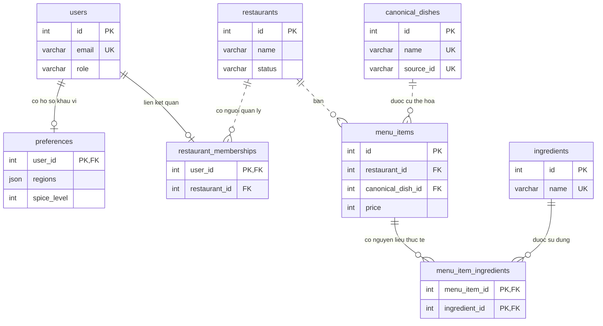
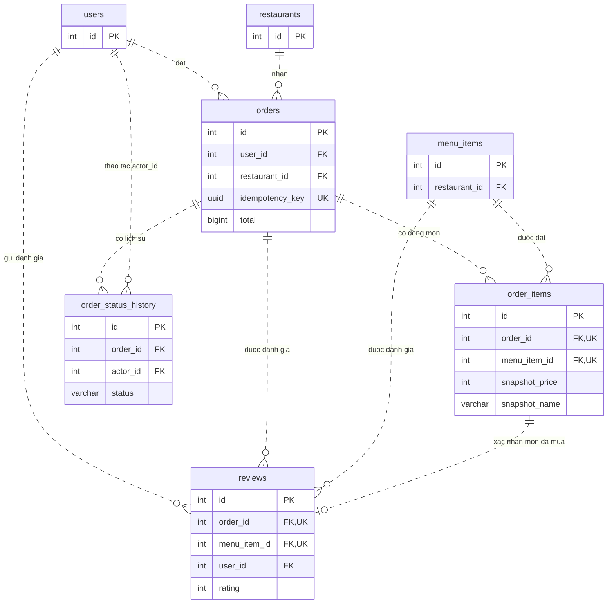
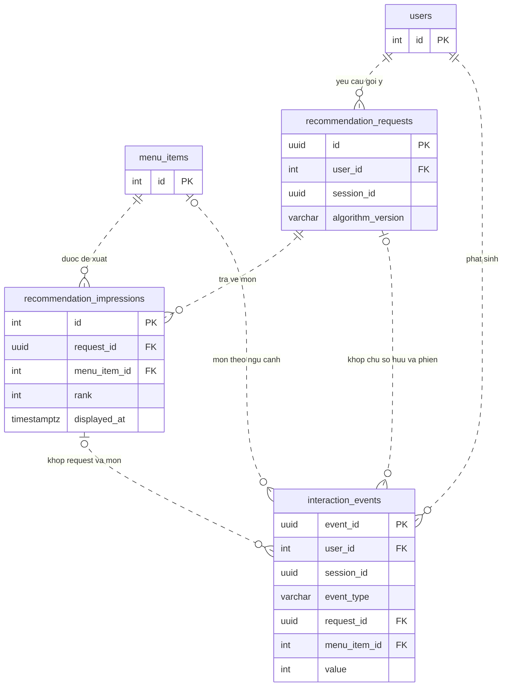

# Sơ đồ quan hệ dữ liệu Vị Việt

Tài liệu thực hiện bước F.7 của [thiết kế cấu trúc](THIET_KE_CAU_TRUC.md), đối chiếu 15 bảng OLTP trong models F.5 và [migration `001`](../src/backend/alembic/versions/001_initial_schema.py). Chi tiết từng cột ở [từ điển dữ liệu](TU_DIEN_DU_LIEU.md). Migration trong backend là nguồn schema duy nhất; sơ đồ không tạo hoặc sửa bảng.

## Cách đọc

Sơ đồ dùng tên bảng thật. `||` là đúng một, `o|` là không hoặc một, `o{` là không hoặc nhiều. Đường liền biểu diễn quan hệ định danh (FK thuộc PK của bảng con); đường đứt biểu diễn các FK còn lại. `PK`, `FK`, `UK` lần lượt là khóa chính, khóa ngoại, khóa duy nhất. Các khóa ghép được giải thích riêng dưới sơ đồ; ký hiệu `UK` trên nhiều cột không có nghĩa từng cột duy nhất độc lập.

Mức tối thiểu của quan hệ phản ánh ràng buộc DB hiện có: một đơn có thể chưa có dòng món/lịch sử ở cấp schema. Service đặt đơn sau này phải tạo đủ dữ liệu trong một transaction. Không thêm thực thể Session, bảng fact, BI view hoặc đánh giá mù vì chúng chưa có trong revision `001`.

## Tài khoản, quán và thực đơn

- `preferences.user_id` là PK/FK: mỗi User có tối đa một hồ sơ, có thể bỏ qua khai báo.
- `restaurant_memberships.user_id` là PK/FK: mỗi tài khoản liên kết tối đa một quán; một quán có thể có nhiều tài khoản quản lý. Membership chưa tự kiểm tra vai trò `vendor`.
- `menu_item_ingredients` có PK ghép `(menu_item_id, ingredient_id)`, biểu diễn quan hệ nhiều–nhiều giữa món bán và nguyên liệu.
- `canonical_dishes.ingredients` là đặc trưng JSON để tham khảo/gợi ý; không phải quan hệ tới bảng `ingredients` và không thay thế nguyên liệu thực tế của món bán.

## Đơn hàng và đánh giá món đã mua

`order_items` có UNIQUE `(order_id, menu_item_id)`. Review có FK ghép tới chính cặp này, đồng thời có UNIQUE trên cặp tương ứng: một dòng món đã mua có tối đa một đánh giá. Hai FK riêng từ Review tới Order/MenuItem vẫn tồn tại trong schema.

`snapshot_name` và `snapshot_price` lưu thông tin tại thời điểm đặt; đổi thực đơn không tự đổi các giá trị đã lưu. DB chưa kiểm tra mọi món thuộc đúng quán của đơn, tổng tiền bằng tổng các dòng, người đánh giá sở hữu đơn hoặc đơn đã hoàn tất. Các điều kiện đó cần service/auth ở bước nghiệp vụ.

## Yêu cầu gợi ý và sự kiện tương tác

- Mỗi Request có từ 0 đến 5 Impression: CHECK `rank` trong 1–5 và UNIQUE `(request_id, rank)` giới hạn tối đa năm dòng. UNIQUE `(request_id, menu_item_id)` ngăn lặp món.
- Request có UNIQUE `(id, user_id, session_id)` làm đích FK ghép của Event. Khi `request_id` có giá trị, Event phải khớp đúng người dùng và phiên.
- FK ghép `(request_id, menu_item_id)` của Event tới Impression bảo đảm món thuộc danh sách của request. Với `add_to_cart` không qua gợi ý, `request_id` có thể NULL; FK riêng tới MenuItem vẫn kiểm tra món tồn tại.
- `session_id` là mã tương quan, không phải FK tới một bảng phiên. Không có FK trực tiếp từ Order tới Request/Event: quy thuộc đơn hàng sẽ được tính ở ETL sau.
- Impression biểu diễn món được trả về; `displayed_at=NULL` nghĩa là chưa ghi nhận hiển thị thực tế. Sự kiện và `displayed_at` chưa được service tự đồng bộ ở bước này.

## Danh mục khóa ngoại và quy tắc xóa

Mỗi dòng dưới đây tương ứng một FK thật, kể cả các FK ghép. `RESTRICT` chặn xóa bản ghi cha đang được tham chiếu; `CASCADE` chỉ xóa những bản ghi con được nêu. Tất cả FK dùng hành vi cập nhật mặc định của DB, không khai báo `ON UPDATE CASCADE`.

| Bảng con | Cột FK | Bảng cha và cột đích | ON DELETE |
| :--- | :--- | :--- | :--- |
| `preferences` | `user_id` | `users(id)` | CASCADE |
| `restaurant_memberships` | `user_id` | `users(id)` | RESTRICT |
| `restaurant_memberships` | `restaurant_id` | `restaurants(id)` | RESTRICT |
| `menu_items` | `restaurant_id` | `restaurants(id)` | RESTRICT |
| `menu_items` | `canonical_dish_id` | `canonical_dishes(id)` | RESTRICT |
| `menu_item_ingredients` | `menu_item_id` | `menu_items(id)` | CASCADE |
| `menu_item_ingredients` | `ingredient_id` | `ingredients(id)` | RESTRICT |
| `orders` | `user_id` | `users(id)` | RESTRICT |
| `orders` | `restaurant_id` | `restaurants(id)` | RESTRICT |
| `order_items` | `order_id` | `orders(id)` | RESTRICT |
| `order_items` | `menu_item_id` | `menu_items(id)` | RESTRICT |
| `order_status_history` | `order_id` | `orders(id)` | RESTRICT |
| `order_status_history` | `actor_id` | `users(id)` | RESTRICT |
| `reviews` | `order_id` | `orders(id)` | RESTRICT |
| `reviews` | `menu_item_id` | `menu_items(id)` | RESTRICT |
| `reviews` | `user_id` | `users(id)` | RESTRICT |
| `reviews` | `(order_id, menu_item_id)` | `order_items(order_id, menu_item_id)` | RESTRICT |
| `recommendation_requests` | `user_id` | `users(id)` | RESTRICT |
| `recommendation_impressions` | `request_id` | `recommendation_requests(id)` | RESTRICT |
| `recommendation_impressions` | `menu_item_id` | `menu_items(id)` | RESTRICT |
| `interaction_events` | `user_id` | `users(id)` | RESTRICT |
| `interaction_events` | `menu_item_id` | `menu_items(id)` | RESTRICT |
| `interaction_events` | `(request_id, user_id, session_id)` | `recommendation_requests(id, user_id, session_id)` | RESTRICT |
| `interaction_events` | `(request_id, menu_item_id)` | `recommendation_impressions(request_id, menu_item_id)` | RESTRICT |

Vì các tham chiếu RESTRICT được giữ lại, xóa User không phải thao tác xóa dây chuyền toàn bộ giao dịch. Việc ngừng bán món, khóa quán hoặc quản lý dữ liệu lịch sử cần được xử lý trong nghiệp vụ sau này.

## Phạm vi kiểm chứng và cập nhật

Revision `001` đã được kiểm thử nâng/hạ/nâng lại và đối chiếu metadata trên SQLite; SQL PostgreSQL mới được kiểm tra offline. Sơ đồ mô tả cấu trúc hiện có, không xác nhận API hoặc máy chủ PostgreSQL đã hoạt động.

Khi thay đổi schema, thêm revision kế tiếp và cập nhật cả ERD lẫn từ điển dữ liệu trong cùng phần thay đổi. Các quy ước ORM và các kiểm tra nghiệp vụ còn thiếu được ghi riêng trong từ điển để tránh hiểu nhầm thành CHECK/FK đã có.
